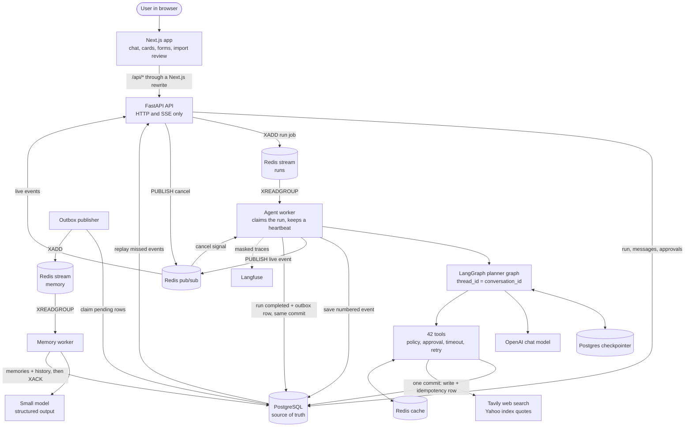
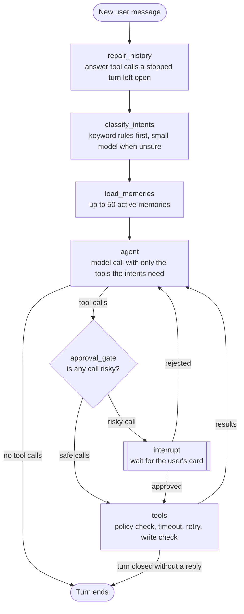
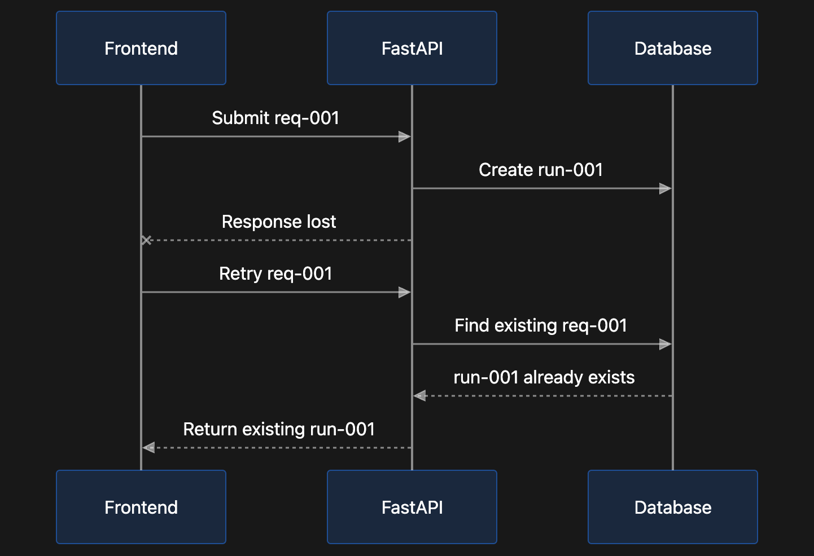

# AI Native Financial Planner

A personal financial planner for Indian households that you use by chatting.
You tell the assistant, **Preeti**, about your income, loans, investments and goals. She saves them as structured records, answers from those records, and runs exact calculations through tools.

The interesting part of this repo is not the chat. It is everything around the model that makes an LLM agent safe to trust with someone's money data: approvals before risky actions, writes that run exactly once, numbers that never come from the model, and runs that survive retries, restarts and several worker processes.

**Stack:** Python 3.13, FastAPI, LangGraph, PostgreSQL, Redis, Next.js 16, React 19, TypeScript, Docker.

---

## Contents

- [What it does](#what-it-does)
- [Architecture at a glance](#architecture-at-a-glance)
- [How one chat turn works](#how-one-chat-turn-works)
- [The agent graph](#the-agent-graph)
- [Engineering decisions and practices](#engineering-decisions-and-practices)
- [Flow diagrams](#flow-diagrams)
- [Tech stack](#tech-stack)
- [Repository layout](#repository-layout)
- [Data model](#data-model)
- [API](#api)
- [Run it locally](#run-it-locally)
- [Tests](#tests)
- [Deployment](#deployment)
- [More documentation](#more-documentation)
- [Known limits](#known-limits)

---

## What it does

| Feature | What the user gets |
|---|---|
| Chat that saves data | "I have an HDFC home loan of 40 lakh" becomes a row in `loans`, after the agent asks for anything missing. |
| Exact answers | Net worth, asset split, monthly cash flow, a health score and goal progress, each worked out in code and shown as a card. |
| Approval cards | Changing or removing a saved item waits for the user's click. The card shows old against new values. |
| Document import | Upload a spreadsheet, CSV, PDF or photo. Code reads and checks every row. The user reviews and approves before anything is saved, and can undo the import. |
| Market information | Search stocks and mutual funds, compare funds, see sector exposure, and get live index levels. |
| Web search | Current news and rule changes, with sources shown as a card. |
| Long-term memory | Preferences and life events ("I avoid tobacco stocks") are picked up after a turn and remembered in later chats. |
| Voice input | Speak a message, including Hindi written in English letters. |
| Live streaming | The reply, each tool step and each card arrive as they happen. A page reload or a dropped connection continues where it stopped. |

---

## Architecture at a glance

The backend is four small processes around two stores. PostgreSQL holds everything that must not be lost. Redis only moves work and live events between processes.



| Process | Entry point | Job |
|---|---|---|
| API | [backend/app/main.py](backend/app/main.py) | HTTP routes and the SSE stream. It starts no background task. |
| Agent worker | [backend/app/features/runs/consumer.py](backend/app/features/runs/consumer.py) | Takes run jobs from Redis, runs the agent, handles cancels, and runs the clean-up sweeps. |
| Outbox publisher | [backend/app/features/outbox/publisher.py](backend/app/features/outbox/publisher.py) | Moves saved events from Postgres to the Redis memory stream. |
| Memory worker | [backend/app/features/memory/worker.py](backend/app/features/memory/worker.py) | Turns finished chats into long-term memories. |

Each process is its own Docker Compose service. The API and both workers can run as several copies, because no state lives in process memory.

---

## How one chat turn works

1. The frontend creates a `client_request_id` and calls `POST /api/runs`.
2. The API saves the run, the user message and an empty assistant message in one transaction, then puts a job on the Redis run stream. It answers `202` at once.
3. The frontend opens `GET /api/runs/{run_id}/events`, a server-sent event stream.
4. An agent worker reads the job and **claims the run in Postgres** (`queued → running`, with its worker id and a heartbeat). Only then does it acknowledge the Redis entry.
5. The worker runs the LangGraph graph with `thread_id = conversation_id`. Earlier turns come from the Postgres checkpointer.
6. Every event (reply text, tool started, tool finished, card) gets a number, is saved in `run_events`, and is then published on Redis.
7. The API sends the events to the browser. After a reconnect it replays the saved events the browser missed, then continues live.
8. The run ends as `completed`, `failed` or `cancelled`, or pauses as `awaiting_approval` until the user answers a card.
9. A completed run writes an outbox row in the same commit. The memory worker later reads it and saves what is worth remembering.

Sequence diagrams for each of these paths are in [docs/flow](docs/flow/README.md).

---

## The agent graph



The graph is built in [backend/app/agent/graph.py](backend/app/agent/graph.py).

| Node | What it does | Code |
|---|---|---|
| `repair_history` | A cancel, timeout or crash can leave a tool call with no reply. This node answers each one, so the next model call is valid. | [repair.py](backend/app/agent/repair.py) |
| `classify_intents` | Finds what the user wants. Keyword rules handle simple messages for free. A small model is called only when the rules are unsure, with a 5 second limit and a safe fallback. | [intents.py](backend/app/agent/intents.py) |
| `load_memories` | Loads the user's saved preferences and life events into the prompt. | [nodes.py](backend/app/agent/nodes.py) |
| `agent` | Calls the model with only the tools the turn's intents need, and tracks the turn's budget. | [nodes.py](backend/app/agent/nodes.py), [selection.py](backend/app/agent/tools/selection.py) |
| `approval_gate` | Pauses the graph before a risky call and resumes with the user's answer. | [approval.py](backend/app/agent/approval.py) |
| `tools` | Runs each call through one wrapper: policy, time limit, safe retry. | [wrapper.py](backend/app/agent/tools/wrapper.py) |

---

## Engineering decisions and practices

### 1. The model never does the maths

- Every number in a reply comes from a tool. The maths lives in [backend/app/calc](backend/app/calc), as pure functions with no database and no model.
- Rich cards are built in code from exact tool data ([blocks.py](backend/app/agent/blocks.py)). The model only places a marker such as `{{card:<id>}}` in its reply; it never sees or rewrites the card's numbers.
- Money is stored as `Numeric`, never as a float.

### 2. Every tool call passes server-side guards

The model proposes a call. The server decides whether it runs.

| Guard | What it does | Code |
|---|---|---|
| Risk policy, deny by default | Every tool has a risk level: `read`, `write`, `sensitive` or `destructive`. A tool with no policy is refused. A test fails if a new tool has none. | [policies.py](backend/app/agent/tools/policies.py) |
| Human approval | Updates, deletes, imports and undo pause the graph with LangGraph `interrupt()`. The approved call must have the same call id and the exact same arguments the user saw. Cards expire after 15 minutes. | [approval.py](backend/app/agent/approval.py), [features/approvals](backend/app/features/approvals) |
| Idempotent writes | Each write is keyed by `(conversation_id, tool_call_id)`. A repeated call returns the saved result and writes nothing. The write and its record are saved by one commit. | [operations.py](backend/app/agent/tools/operations.py) |
| Read-back check | After a write, the row is read back and compared with what was asked. A difference rolls the write back. | [verify.py](backend/app/services/verify.py) |
| Typed results | Every tool returns one shape with a fixed `status`. The prompt has one rule per status, so the model never guesses what happened. | [results.py](backend/app/agent/tools/results.py) |
| Time limits and retries | 90 seconds per turn, 10 per tool try, 8 per SQL statement. Each inner limit is shorter than the outer one. Reads always retry. Writes retry only where the idempotency guard makes it safe. | [limits.py](backend/app/agent/tools/limits.py), [wrapper.py](backend/app/agent/tools/wrapper.py) |
| Turn budget | At most 12 model calls, 20 tool calls and 12,000 output tokens per turn. At a limit the agent writes one short closing reply instead of failing. Usage and cost are saved on each run. | [budget.py](backend/app/agent/budget.py) |
| Row ownership | `user_id` comes from the session, never from the model's arguments. Every query filters by it. | [context.py](backend/app/agent/context.py), [base_repository.py](backend/app/features/records/base_repository.py) |

### 3. Runs are reliable across processes

- **Postgres is the truth, Redis is transport.** Losing a Redis message never loses data. A sweep finds and repairs what Redis dropped.
- **Idempotent requests.** A retried `POST /api/runs` with the same `client_request_id` returns the first run. A unique index settles two retries that race.
- **One active run per conversation**, enforced by a partial unique index, not by application code.
- **Claim, then acknowledge.** A worker acknowledges a Redis job only after it has claimed the run in Postgres. A second delivery of the same job is skipped.
- **Heartbeats and sweeps.** A run whose worker stops its heartbeat is failed after 60 seconds. Jobs a dead worker left behind are taken over. A job delivered more than 3 times fails its run.
- **Events that can be replayed.** Each event is numbered and saved before it is published. The stream subscribes to Redis first and then reads the saved rows, so nothing falls in between and nothing repeats ([stream.py](backend/app/features/runs/stream.py)).
- **Cancel that always lands.** Stop is a saved status plus a Redis signal. If the signal is missed, the run reads the status before every model call and tool call.
- **Durable conversation state.** The LangGraph checkpointer is on Postgres, so a paused approval or a long chat survives restarts and deploys, and any worker can resume it.

### 4. Background work uses the transactional outbox

- A finished run and its "extract memories" event are saved in the same commit. The app never publishes to Redis straight after a database write.
- The publisher claims rows with `FOR UPDATE SKIP LOCKED`, backs off on errors, and marks a row `dead_letter` after 5 tries.
- The memory worker acknowledges a stream entry only after its Postgres commit, and every handler is safe to run twice.
- Each worker reads Redis under its own consumer name (`hostname:pid`), so copies never take each other's entries.

### 5. Memory is split by what it is for

| Kind | Where | Written by |
|---|---|---|
| Financial facts | Typed tables (`loans`, `goals`, `holdings`, …) | Tools, during the turn |
| Conversation state | LangGraph checkpointer in Postgres | The graph, after every node |
| Display history | `messages`, `tool_calls` | The agent worker |
| Preferences and life events | `memory_items`, with full history in `memory_events` | The memory worker, after the turn |

A preference memory may never hold a balance, an income or any value a table already owns ([rules.py](backend/app/features/memory/rules.py)). It must come from the user's own words, and a low-confidence one is kept as a candidate, not used.

### 6. Document import: code reads, the user decides

- Code reads and cleans every value. The model may read a layout or a page, but it never writes a record.
- For an unknown sheet, the model sees only the headings and samples with the digits hidden. A full page goes to the model only after the user agrees.
- Every row is checked: needed fields, real dates, stock and fund matching, duplicates, and the totals the statement itself prints.
- When the code is unsure, it asks the user. It never picks on its own.
- Nothing is saved until the user presses Import. Each write is read back, and the whole import can be undone.

Full design: [docs/document-import.md](docs/document-import.md). Code: [backend/app/features/documents](backend/app/features/documents).

### 7. Privacy and security

- Passwords are hashed with Argon2. The session is a signed JWT in an `httpOnly`, `SameSite=Lax` cookie.
- The browser calls the API through a Next.js rewrite, so there is one origin and no CORS surface ([next.config.ts](frontend/next.config.ts)).
- Traces sent to Langfuse are masked first: tool inputs and outputs are dropped, and emails, PAN, Aadhaar, phone and account-like numbers are hidden. If masking fails, the span's content is dropped ([masking.py](backend/app/observability/masking.py)).
- Web search results are cached for all users, so the cache key never includes a user, and the prompt keeps personal data out of queries.
- The page-preview fetcher opens only public web addresses, with limits on redirects and size ([preview.py](backend/app/features/web_search/preview.py)).
- A PDF password is used once and never saved. Voice recordings are never saved.

### 8. Cost and speed

- Only the tools a turn needs are sent to the model, chosen from its intents. This keeps the prompt small and the tool choice sharp.
- The intent step costs nothing for simple messages, because keyword rules answer first.
- Web search and index quotes are cached in Redis by how fast they go stale. A lock lets one caller search while others wait for its result.
- Token use and cost are saved per run on `agent_runs`.

### 9. Observability that cannot break a turn

- Each agent turn is one Langfuse trace, with a span for every model call, guard and tool try.
- Every tracing helper catches its own errors. With no keys set, tracing is simply off.

### 10. Code structure and style

- **One folder per feature**, each with `router`, `service`, `repository` and `schemas` ([backend/app/features](backend/app/features)). Routers hold no business rules, and repositories hold no decisions.
- **Services flush, callers commit.** This is what lets a write and its idempotency row share one commit.
- **One generic repository** for every table a user owns, so ownership checks are written once.
- **One place for the model** ([llm.py](backend/app/services/llm.py)) and **one place for settings** ([config.py](backend/app/core/config.py)). Every limit and timeout is a named setting.
- **Schema changes only through Alembic.** 25 migrations, from `0001` to `0025`.
- **Every module and function has a one-line docstring** that says what it is for, in plain words.
- **Typed frontend contract.** The SSE events and UI block types are typed on both sides ([events.py](backend/app/features/runs/events.py), [types.ts](frontend/lib/types.ts)).

---

## Flow diagrams

All diagrams live in [docs/flow](docs/flow/README.md), each with its Mermaid source.

| Diagram | Shows |
|---|---|
| [System architecture](docs/flow/README.md#1-system-architecture) | Every process, store and outside service. |
| [Agent graph](docs/flow/README.md#2-agent-graph) | The nodes one chat turn passes through. |
| [Run lifecycle](docs/flow/README.md#3-run-lifecycle) | The states of one run, from message to end. |
| [Send a message](docs/flow/README.md#4-send-a-message) | One turn across the API, Redis, the worker and Postgres. |
| [Cancel a run](docs/flow/README.md#5-cancel-a-run) | How Stop reaches a run in another process. |
| [Idempotent retry](docs/flow/README.md#6-idempotent-retry) | Why a retried request never creates a second run. |
| [Approval before a risky tool call](docs/flow/README.md#7-approval-before-a-risky-tool-call) | Pause, show a card, resume on any worker. |
| [Memory pipeline](docs/flow/README.md#8-memory-pipeline) | Outbox, Redis stream and the memory worker. |
| [Document import](docs/flow/README.md#9-document-import) | From an uploaded file to approved rows. |

Example, the idempotent retry:



---

## Tech stack

| Area | Choice |
|---|---|
| Language and tooling | Python 3.13, `uv`, `hatchling` |
| API | FastAPI, Uvicorn, server-sent events |
| Agent | LangGraph `StateGraph`, LangChain tools, `interrupt()` for approvals |
| Models | OpenAI through `langchain-openai`: a chat model for the agent, a small model for intents and memory, a speech-to-text model for voice |
| Database | PostgreSQL, SQLAlchemy 2 (async), psycopg 3, Alembic |
| Conversation state | `langgraph-checkpoint-postgres` |
| Queue, events, cache | Redis streams with consumer groups, pub/sub, keys with a TTL |
| Auth | Argon2 (`pwdlib`), JWT (`pyjwt`) in an httpOnly cookie |
| Documents | `openpyxl`, `xlrd`, `pdfplumber` |
| Outside data | Tavily (web search), Yahoo Finance chart API (index quotes) |
| Tracing | Langfuse, with span masking |
| Frontend | Next.js 16, React 19, TypeScript, Tailwind CSS 4, Recharts, Framer Motion, KaTeX, lucide icons |
| Tests | pytest, pytest-asyncio |
| Deploy | Docker, Docker Compose, Caddy (HTTPS), Neon Postgres, Upstash Redis |

---

## Repository layout

```
ai-native-fpa/
├── backend/
│   ├── app/
│   │   ├── main.py            FastAPI app
│   │   ├── api/               top-level router, current-user dependency
│   │   ├── core/              settings, shared Redis client and stream helpers
│   │   ├── db/                engine and session, enums, table models
│   │   ├── agent/             graph, nodes, prompt, intents, approval gate, budget, UI blocks
│   │   │   └── tools/         42 tools, plus policy, wrapper, limits, idempotency, results
│   │   ├── features/          one folder per feature: router / service / repository / schemas
│   │   │   ├── runs/          start, stream, cancel; job queue, worker, event publisher
│   │   │   ├── approvals/     decide, auto-reject, expire
│   │   │   ├── documents/     upload, read, parse, check, review, import, undo
│   │   │   ├── memory/        extractor, rules, worker
│   │   │   ├── outbox/        outbox repository and publisher
│   │   │   ├── investments/   holdings, SIPs, market data queries
│   │   │   ├── overview/      net worth, asset split, cash flow, health score
│   │   │   └── …              auth, conversations, records, profile, cash_flow, assets,
│   │   │                      liabilities, protection, planning, coverage, analysis,
│   │   │                      indices, web_search, voice, operations
│   │   ├── calc/              pure money maths
│   │   ├── observability/     Langfuse client, masking, manual spans
│   │   └── services/          the model factory, the write check
│   ├── alembic/versions/      25 migrations
│   ├── scripts/market_data/   download and load stock, fund and portfolio data
│   ├── tests/                 457 tests, one folder per area
│   ├── deploy/                Caddyfile, VM setup script, deploy guide
│   ├── Dockerfile
│   └── docker-compose.yml     production stack
├── frontend/
│   ├── app/                   planner page, sign in, sign up
│   ├── components/
│   │   ├── chat/              workspace, timeline, composer, approval card, file chips
│   │   ├── blocks/            one card per UI block type
│   │   ├── imports/           import review panel
│   │   └── forms/, ui/, icons/, dashboard/
│   └── lib/                   API client, SSE stream, types, session, voice, uploads
└── docs/                      architecture notes and flow diagrams
```

A fuller map is in [docs/folder.md](docs/folder.md).

---

## Data model

- All ids are `BIGINT` identity columns. All timestamps are `TIMESTAMPTZ`.
- Table models are in [backend/app/db/models](backend/app/db/models).

| Group | Tables |
|---|---|
| Chat and runs | `conversations`, `messages`, `agent_runs`, `run_events`, `tool_calls` |
| Tool safety | `tool_approvals`, `tool_operations` |
| User's finances | `users`, `family_members`, `income_sources`, `expenses`, `transactions`, `bank_accounts`, `fixed_deposits`, `retirement_accounts`, `physical_assets`, `loans`, `credit_cards`, `insurance_policies`, `goals`, `goal_allocations`, `assumptions`, `tax_profile`, `holdings`, `sip_plans`, `data_coverage` |
| Shared market data | `stocks`, `mutual_funds`, `fund_holdings` |
| Memory and events | `memory_items`, `memory_events`, `outbox_events` |
| Document import | `documents`, `import_rows`, `layout_mappings` |
| Conversation state | LangGraph checkpoint tables, owned by LangGraph and left out of Alembic |

Constraints carry the rules that must never break: one active run per conversation, one request id per conversation, one pending approval per tool call, one active memory per key.

---

## API

All routes are under `/api`, except `/health`. All but sign up, sign in and sign out need the session cookie.

| Method and path | What it does |
|---|---|
| `POST /api/auth/signup`, `/signin`, `/signout`, `GET /api/auth/me` | Account and session |
| `POST /api/runs` | Start a turn from a message or a filled form. Answers `202`. |
| `GET /api/runs/{run_id}/events` | SSE stream. `?after=N` or `Last-Event-ID` replays missed events. |
| `POST /api/runs/{run_id}/cancel` | Ask the run to stop |
| `POST /api/runs/{run_id}/approvals/{approval_id}` | Answer an approval card |
| `GET /api/conversations`, `GET / PATCH / DELETE /api/conversations/{id}` | Chat history: list, open, rename, soft delete |
| `POST /api/voice/transcribe` | Recording in, text out |
| `POST /api/documents`, `GET /api/documents`, `GET /api/documents/{id}` | Upload a file, list uploads, read one with its rows |
| `POST /api/documents/{id}/mapping`, `/answers`, `/as-of-date`, `/password`, `/read-pages`, `/accept-totals` | The review steps |
| `PATCH / DELETE /api/documents/{id}/rows/{row_id}`, `POST …/restore` | Edit, remove or bring back one row |
| `POST /api/documents/{id}/approve`, `/undo` | Import the ready rows, or undo the import |

SSE events: `assistant.delta`, `assistant.snapshot`, `tool.started`, `tool.finished`, `ui.block`, `approval.required`, `run.completed`, `run.failed`, `run.cancelled`.

There are no routes to edit financial records directly. The agent's tools and the import review are the only ways in, so every change passes the same guards.

---

## Run it locally

You need Docker, Python 3.13 with [uv](https://docs.astral.sh/uv/), Node 20+ with pnpm, and an OpenAI API key.

**1. Start Postgres and Redis**

```bash
docker run -d --name fpa-postgres -p 5433:5432 \
  -e POSTGRES_USER=postgres -e POSTGRES_PASSWORD=postgres -e POSTGRES_DB=fpa postgres:17

docker run -d --name fpa-redis -p 6380:6379 redis:7.4-alpine redis-server --appendonly yes
```

**2. Set up the backend**

```bash
cd backend
cp .env.example .env        # then set OPENAI_API_KEY and JWT_SECRET
uv sync
uv run alembic upgrade head
```

**3. Start the four backend processes**, each in its own terminal, from `backend/`

```bash
uv run fastapi dev app/main.py
uv run python -m app.features.runs.consumer
uv run python -m app.features.outbox.publisher
uv run python -m app.features.memory.worker
```

**4. Start the frontend**

```bash
cd frontend
pnpm install
pnpm dev
```

Open http://localhost:3000 and sign up.

Notes:

- Web search needs `TAVILY_API_KEY`. Tracing needs the two `LANGFUSE_*` keys. Both are optional.
- Stock and fund tools need market data, loaded with the scripts in [backend/scripts/market_data](backend/scripts/market_data). Everything else works without it.

---

## Tests

```bash
cd backend
uv run pytest
```

- 457 tests, grouped by area: agent, approvals, tools, documents, runs, memory, outbox, observability, calc, voice.
- They run against a real Postgres and a real Redis, not mocks, because the guarantees being tested live in constraints, transactions and streams.
- No test calls a real model or sends a trace. Two autouse fixtures in [conftest.py](backend/tests/conftest.py) turn both off.
- Some tests exist only to protect a rule: every tool must have a risk policy, and every tool must belong to an intent group.

---

## Deployment

The demo runs at zero cost.

- One free-tier GCP e2-micro VM runs the API, the three workers and Caddy for HTTPS ([backend/docker-compose.yml](backend/docker-compose.yml)).
- Postgres is on Neon and Redis is on Upstash.
- All four backend services share one image ([Dockerfile](backend/Dockerfile)).
- Step-by-step guide: [backend/deploy/README.md](backend/deploy/README.md).

---

## More documentation

| Document | What is in it |
|---|---|
| [docs/PROJECT_CONTEXT.md](docs/PROJECT_CONTEXT.md) | The deep reference: request lifecycle step by step, every guard, every setting, the data model and the rules to keep when changing the agent. |
| [docs/flow/README.md](docs/flow/README.md) | All flow diagrams. |
| [docs/document-import.md](docs/document-import.md) | Design of the document import. |
| [docs/folder.md](docs/folder.md) | Folder map of the backend and frontend. |
| [docs/MEMORY_IMPLEMENTATION_HANDOFF.md](docs/MEMORY_IMPLEMENTATION_HANDOFF.md) | The original plan for the memory pipeline, with a note on what changed when it was built. |
| [backend/deploy/README.md](backend/deploy/README.md) | Deploy guide for the free-tier VM. |
| [frontend/DESIGN.md](frontend/DESIGN.md) | The design system: colours, type, spacing and components. |

---

## Known limits

Listed plainly, because knowing them is part of the design.

- **History is not trimmed.** Each turn is capped, but a very long chat still sends all its messages. Summary columns exist and are not used yet.
- **Crashed runs are failed, not resumed.** Resuming from the checkpoint is now safe for writes, thanks to the idempotency guard, but it is not switched on.
- **Memories cannot be managed by the user yet.** There is no screen to list, correct or delete a saved preference.
- **No audit trail for edits to financial rows.** Approval cards keep old and new values, but the tables themselves keep only the latest.
- **No CI pipeline.** Tests are run by hand before a merge.
- **Single role.** One signed-in person owns their own data. There is no advisor or family sharing.
