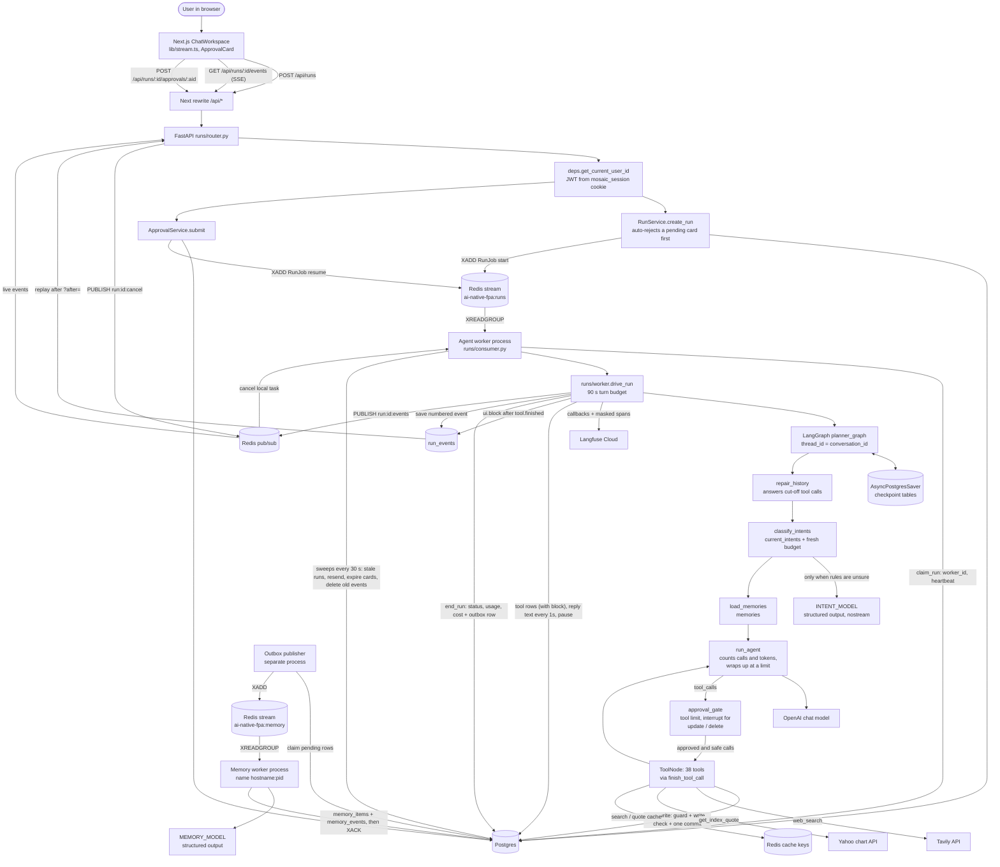
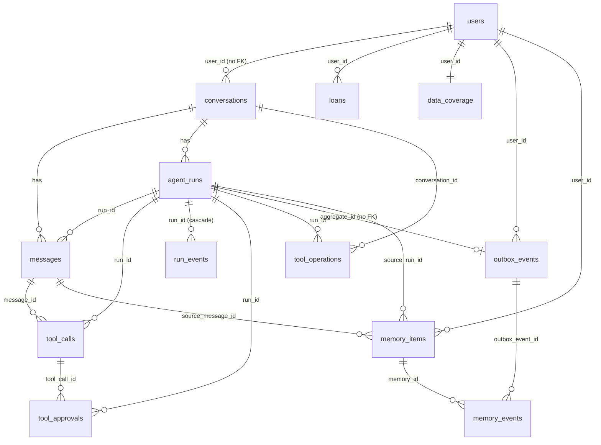

# Project Context — AI Native Financial Planner

Snapshot of the code on branch `feat-langfuse` at commit `0117815` (9 November 2026).

Between `04f8eb8` (30 October 2026) and `0117815`, 30 commits added:
- **Investments**: stock and mutual fund holdings and SIPs are now saved by the agent (`add_stock_or_fund`, `add_sip_plan`),
  with market master data (`stocks`, `mutual_funds`) and fund portfolios (`fund_holdings`, migration `0020`);
- **Market tools**: search, fund and stock details, fund compare, portfolio exposure, and live index quotes (Yahoo chart API);
- **Web search** through Tavily, cached in Redis by freshness;
- **Overview tools**: net worth, asset split, month summary, cash flow history, financial health score, upcoming events;
- **UI blocks**: most tools now return a typed card (`block`), sent as a new `ui.block` SSE event and placed in the reply by `{{card:<id>}}`;
- **Forms**: `open_form` opens a form panel; a filled form comes back as a normal `POST /api/runs` with a `form` body;
- **Write check**: every write reads its row back and returns `verified`, or `mismatch` with the wrong fields;
- **Confirm cards**: `add_stock_or_fund` with only an amount, and an FD at a bank that also runs funds, pause for the user;
  the user can fix units or amount on the card (`edits`);
- **Voice input**: `POST /api/voice/transcribe` (OpenAI `gpt-4o-mini-transcribe`);
- **Langfuse tracing** of every agent turn, with personal data masked (section 2.7);
- `CHAT_MODEL` is now `gpt-5.6-luna` with `reasoning_effort="none"`; `langsmith` was removed;
- tool count went from 22 to **38**, and a new intent `MARKET_INFO`;
- `backend/docker-compose.yml` now runs Postgres too.

Since `71b5d8b` (29 October 2026) the backend is **multi-process**:
- runs go through a **Redis job queue** (`ai-native-fpa:runs`) to a separate **agent worker**, which claims each run in Postgres and keeps a heartbeat;
- every SSE event is **numbered and saved** in `run_events`, sent live on Redis pub/sub, and **replayed after a reconnect** (`?after=`);
- **cancel** is a saved status checked before every model and tool call, plus a Redis cancel signal;
- the **memory worker** is its own process, and every Redis consumer reads under a unique `hostname:pid` name;
- the **API starts no background task**. Agent worker, memory worker and outbox publisher are separate compose services.

The previous snapshot was `116c5b1` (23 October 2026). Between it and `71b5d8b`:
- an **intent classifier** runs once at the start of every turn and saves `current_intents` (a list) in the state;
- the agent is given **only the tools its intents need** (`agent/tools/selection.py`), all tools for a general question;
- a **history repair** node fixes a thread left with unanswered tool calls by a cancel, timeout or crash;
- the backend has a **Dockerfile** and a `backend/docker-compose.yml` (API, outbox publisher, Redis);
- `tavily-python` was added as a dependency (now used by web search).

Between `ba3613f` (20 October 2026) and `116c5b1`, every tool call got a set of safety layers:
- an **approval gate**: the user approves or rejects a delete or an update on a card before it runs;
- **typed tool results**: every tool returns one JSON shape with a fixed `status`;
- a **risk policy** for every tool, with deny by default;
- **idempotency**: a write runs once per tool call (`tool_operations`);
- **timeouts and retries** for each tool, and a time budget for each turn;
- **loop and cost limits** for each turn, with usage and cost saved on `agent_runs`;
- **paging, filters, sort and chosen fields** in `list_records`. The 5 s demo delays are gone;
- the `find_*` duplicate checks are gone, so two real loans from one lender can both be saved.

Everything here was read from the code. Where a doc in the repo disagrees with the code, the code wins.
Those stale docs are listed in section 8. The old root design notes (`TOOL_RESULTS.md`, `IDEMPOTENCY.md`,
`INTENT_FLOW.md`, `SCALING_FLOW.md`) are no longer in the repo; this file is the only overview.

---

## 1. Project overview

### 1.1 Purpose

A personal financial planner for Indian households, driven by chat.

- The user talks to an agent named **Preeti**.
- Preeti saves the user's financial details into Postgres as structured rows.
- Preeti answers questions from those rows and runs exact calculations through tools.
- The model is told never to do maths itself. Every number must come from a tool.
- Removing or changing a saved item waits for the user's click on an Approve / Reject card.
- Preeti also looks up stocks, mutual funds, index levels and web news, and shows results as typed cards.
- Missing details can be filled in a form panel. The user can also speak a message (voice to text).
- After each chat turn, a background worker pulls out lasting preferences and life events.
  These are shown to Preeti in later chats ("avoids sectors: tobacco").

### 1.2 Financial use case

| Area | What is stored | Tables |
|---|---|---|
| Profile | Name, DOB, city, risk appetite, retirement age, life expectancy | `users` |
| Family | Spouse, children, parents, dependants | `family_members` |
| Cash flow | Regular income, regular expenses, one-off transactions | `income_sources`, `expenses`, `transactions` |
| Assets | Bank accounts, FD/RD, EPF/PPF/NPS/VPF, property, gold, vehicles | `bank_accounts`, `fixed_deposits`, `retirement_accounts`, `physical_assets` |
| Liabilities | Loans, credit cards | `loans`, `credit_cards` |
| Protection | Term, health, life, ULIP, vehicle policies | `insurance_policies` |
| Planning | Goals, goal-to-asset allocations, rate assumptions, tax regime | `goals`, `goal_allocations`, `assumptions`, `tax_profile` |
| Investments | Stock and mutual fund holdings (units, invested amount, current value), SIP plans | `holdings`, `sip_plans` |
| Market data (read-only, loaded by scripts) | Stock and fund master lists with latest price / NAV, each fund's monthly portfolio | `stocks`, `mutual_funds`, `fund_holdings`, view `fund_sector_allocation` |
| Onboarding | Per-section status: pending / provided / none / declined (now incl. `holdings`, migration `0021`) | `data_coverage` |
| Preferences and life events | Sectors to avoid or prefer, answer style, past decisions, life events | `memory_items`, `memory_events` |
| Tracking (not wired) | Net worth by date | `net_worth_snapshots` |

Currency is INR. Amounts are `Numeric(14, 2)`. Rates are `Numeric(5, 2)` percent values.
Prices are `Numeric(14, 4)` and units `Numeric(18, 4)` (`db/models/investments.py`).

- `stocks`, `mutual_funds`, `holdings` and `sip_plans` existed since `0005`/`0006`; they now have models.
- Only `net_worth_snapshots` still has no SQLAlchemy model. `alembic check` reports it.
- A holding points at exactly one of `stock_id` or `mutual_fund_id`. A SIP points at a holding (`holding_id`).
- Market data is loaded by `backend/scripts/market_data/` (section 2.8), not by the agent.

Duplicates: the `add_*` services no longer refuse "the same lender and type" or "the same name".
Two HDFC home loans can both be saved. The prompt makes the agent call `list_records` first and ask
"is this a new one?". Only `add_family_member` still refuses the same name and relation,
because goals and policies find a family member by name. The `set_*` tools and `link_asset_to_goal` update the existing row.
Holdings are the other exception: `add_stock_or_fund` refuses a second holding of the same stock or fund (`RecordExists`
with a hint to update it), and `add_sip_plan` refuses an active SIP with the same amount and day.
An update that changes nothing is refused: "Nothing to change: these values are already saved for this …".

### 1.3 User types and roles

- **One role only:** a signed-in individual who owns their own data.
- No admin, advisor, family-sharing or organisation roles exist.
- Authorization is row scoping by `user_id`, plus a per-tool risk policy (section 2.4). There is no RBAC.
- Note: the system prompt says Preeti helps "finance teams and business owners".
  The tools and tables are personal finance. This mismatch is worth fixing.

### 1.4 Technologies

**Backend** — Python 3.13, managed with `uv` (`backend/pyproject.toml`)

| Concern | Choice |
|---|---|
| HTTP | FastAPI + Uvicorn |
| Agent | LangGraph `StateGraph` + `ToolNode` (with an `awrap_tool_call` wrapper), LangChain tools |
| Human approval | LangGraph `interrupt()` and `Command(resume=…)`, state kept by the checkpointer |
| Model | OpenAI via `langchain-openai`, `stream_usage=True`. `CHAT_MODEL` = `gpt-5.6-luna` (with `reasoning_effort="none"`); `MEMORY_MODEL` and `INTENT_MODEL` = `gpt-4o-mini`; `TRANSCRIBE_MODEL` = `gpt-4o-mini-transcribe` |
| Database | PostgreSQL, SQLAlchemy 2 async, psycopg 3 driver, `connect_timeout` 5 s |
| Migrations | Alembic, `0001` to `0021` |
| Web search | Tavily (`tavily-python`, `AsyncTavilyClient`), results cached in Redis |
| Index quotes | Yahoo Finance chart API over `httpx`, cached in Redis |
| Tracing | Langfuse (`langfuse` ≥ 5.2) LangChain `CallbackHandler`, with span masking. Off when keys are missing |
| Conversation state | `AsyncPostgresSaver` (`langgraph-checkpoint-postgres`) on a psycopg pool |
| Event transport | Redis via `redis` 8 (`redis.asyncio`): streams `ai-native-fpa:runs` (group `agent-workers`) and `ai-native-fpa:memory` (group `memory-workers`); pub/sub channels `ai-native-fpa:run:{id}:events` and `:cancel` |
| Auth | Argon2 (`pwdlib`) passwords, HS256 JWT (`pyjwt`) in an httpOnly cookie |
| Streaming | Server-sent events: replayed from `run_events` in Postgres, then live from Redis pub/sub |
| Tests | `pytest` + `pytest-asyncio`, against real Postgres and Redis. 352 collected. 5 outbox tests skip when the dev DB has pending rows. Autouse fixtures in `tests/conftest.py`: the intent model returns the fallback, and Langfuse keys are cleared (`no_langfuse`) so no test sends a trace |
| Container | `backend/Dockerfile` (`python:3.13-slim` + `uv`, runs `fastapi run`), `backend/docker-compose.yml` |
| Installed, not used yet | `tenacity`, `pycryptodome`, `pdfplumber` |

**Backend packages** (`backend/pyproject.toml`, build with `hatchling`)

| Package | Used for |
|---|---|
| `fastapi[standard]`, `uvicorn[standard]` | HTTP API and server |
| `python-multipart` | multipart form body for voice upload |
| `pydantic`, `pydantic-settings` | request / tool schemas, `Settings` from env |
| `langgraph`, `langchain`, `langchain-openai` | agent graph, tools, OpenAI chat models |
| `langgraph-checkpoint-postgres`, `psycopg[binary,pool]` | conversation state in Postgres, psycopg 3 driver and pool |
| `sqlalchemy[asyncio]` ≥ 2.0, `alembic` | ORM and migrations |
| `redis` ≥ 8.1 | streams, pub/sub, caches, locks |
| `orjson` | fast JSON for Redis events, outbox and memory |
| `pwdlib[argon2]`, `pyjwt` | password hashing, session JWT |
| `tavily-python` | web search |
| `httpx` | Yahoo chart API, web page previews |
| `langfuse` ≥ 5.2 | tracing (section 2.7) |
| `openpyxl`, `xlrd` | reading AMC portfolio Excel files in `scripts/market_data/` only |
| `tenacity`, `pycryptodome`, `pdfplumber` | installed, not used |

Dev group: `pytest`, `pytest-asyncio` (`asyncio_mode = "auto"`), `pytest-cov`. `respx`, `hypothesis` and `freezegun`
are installed but no test imports them.

**Frontend packages** (`frontend/package.json`, pnpm)

| Package | Used for |
|---|---|
| `next` 16.3.4, `react` / `react-dom` 19.2.8 | app framework (this Next.js has breaking changes; see `frontend/AGENTS.md`) |
| `tailwindcss` 4, `@tailwindcss/postcss` | styling |
| `recharts` 3 | charts in cards (bars, ring, …) |
| `framer-motion` 13 | animations |
| `katex` 0.16.22 | maths formulas in replies |
| `lucide-react` | icons (plus custom `FinIcons`) |
| `typescript` 5, `eslint` 9, `eslint-config-next` | types and lint |

**Services** — Postgres, Redis, the OpenAI API, Tavily, Yahoo Finance and Langfuse Cloud. No object storage, no vector store.

### 1.4a API endpoints

All routes are under `/api` (`app/api/router.py`), except `/health`. Every route except signup, signin, signout and
`/health` needs the `mosaic_session` cookie.

| Method and path | What it does | Source |
|---|---|---|
| `GET /health` | liveness check (compose health check) | `main.py` |
| `POST /api/auth/signup` | create a user, set the cookie (`201`) | `features/auth/router.py` |
| `POST /api/auth/signin` | check password, set the cookie | same |
| `POST /api/auth/signout` | clear the cookie (`204`) | same |
| `GET /api/auth/me` | the signed-in user | same |
| `POST /api/runs` | start a turn from `message` or `form` (`202 {run_id, conversation_id, status}`) | `features/runs/router.py` |
| `GET /api/runs/{run_id}/events` | SSE stream; `?after=N` or `Last-Event-ID` to replay (section 7) | same |
| `POST /api/runs/{run_id}/cancel` | ask the run to stop (`202`) | same |
| `POST /api/runs/{run_id}/approvals/{approval_id}` | answer a card: `{decision, edits?}` | same |
| `GET /api/conversations` | the user's chats, `?limit=` 1–200 (default 50) | `features/conversations/router.py` |
| `GET /api/conversations/{id}` | one chat: messages, tools, `blocks`, `form`, `active_run` | same |
| `PATCH /api/conversations/{id}` | rename | same |
| `DELETE /api/conversations/{id}` | soft delete (`204`); refused while a card is pending | same |
| `POST /api/voice/transcribe` | multipart `audio` → `{text}` | `features/voice/router.py` |

There are no routes for records, memories, documents or the dashboard. The agent's tools are the only way to read
or change financial data.

### 1.4b Agent tools (38)

| Group | Tools |
|---|---|
| Records | `list_records`, `update_record`, `delete_record`, `get_missing_sections`, `mark_section_status` |
| Profile and family | `update_profile`, `add_family_member` |
| Cash flow | `add_income_source`, `add_expense`, `add_transaction` |
| Assets | `add_bank_account`, `add_fixed_deposit`, `add_retirement_account`, `add_physical_asset` |
| Investments | `add_stock_or_fund`, `add_sip_plan` |
| Liabilities | `add_loan`, `add_credit_card` |
| Protection | `add_insurance_policy` |
| Planning | `add_goal`, `link_asset_to_goal`, `set_planning_rate`, `set_tax_profile`, `check_goal_progress` |
| Market | `search_stocks_and_funds`, `get_fund_details`, `get_stock_details`, `compare_funds`, `get_portfolio_exposure`, `get_index_quote` |
| Web | `web_search` |
| Overview | `get_net_worth`, `get_asset_split`, `get_month_summary`, `get_cash_flow_history`, `get_financial_health`, `get_upcoming_events` |
| Forms | `open_form` |

Risk and approval for each tool: section 2.2, step 7. Which intent gets which tool: step 6.

### 1.4c Processes and workers

| Process | Entry point | Job |
|---|---|---|
| API | `app/main.py` | HTTP only |
| Agent worker | `app/features/runs/consumer.py` | runs turns from `ai-native-fpa:runs`; cancel listener; 30 s sweeps (stale runs, resend, expire cards, delete old events); Langfuse |
| Memory worker | `app/features/memory/worker.py` | reads `ai-native-fpa:memory`, saves preferences and life events |
| Outbox publisher | `app/features/outbox/publisher.py` | moves `outbox_events` rows to the memory stream |
| Market data scripts | `scripts/market_data/*.py` | run by hand to load stocks, funds and fund portfolios |

Details: section 1.6 (commands, compose) and section 2.2 step 10 (what each loop does).

### 1.5 Repository structure

```
ai-native-fpa/
├── backend/
│   ├── app/
│   │   ├── main.py              FastAPI app; mounts routes, starts no background task, closes pools on shutdown
│   │   ├── api/                 router.py (mounts /api: auth, runs, conversations, voice), deps.py (current user)
│   │   ├── core/
│   │   │   ├── config.py        Settings from env, incl. timeouts and turn limits
│   │   │   └── redis.py         shared Redis client, stream helpers (XADD, XREADGROUP, XACK, …), process_name, prune_consumers
│   │   ├── db/                  session.py (engine, Base), enums.py, models/ (incl. approvals.py, operations.py)
│   │   ├── agent/
│   │   │   ├── graph.py         repair_history → classify_intents → load_memories → agent → approval_gate → tools → agent …
│   │   │   ├── nodes.py         repair_history, classify_intents, load_memories, run_agent, wrap_up, node names
│   │   │   ├── intents.py       intent names, keyword rules, intent model call, fallback
│   │   │   ├── repair.py        repaired_history: a stopped reply for every unanswered tool call
│   │   │   ├── approval.py      approval_gate node, previews (remove, change, move, confirm, deposit), edits
│   │   │   ├── cards.py         plain-words helpers for approval previews (labels, rupees, titles, notes)
│   │   │   ├── blocks.py        builders for typed UI blocks (table, hero, ring, quote, sources, …); never raise
│   │   │   ├── forms.py         FormKind, allowed form fields, form titles, form_text for a submitted form
│   │   │   ├── budget.py        per-turn model, tool and token counts, limit checks, cost
│   │   │   ├── cancellation.py  stop_if_cancelled: the saved-cancel check before model and tool calls
│   │   │   ├── state.py, context.py, prompt.py, checkpointer.py
│   │   │   └── tools/
│   │   │       ├── results.py   ToolResult (incl. block, verified), status helpers, card hint, to_message
│   │   │       ├── policies.py  Risk, ToolPolicy, TOOL_POLICIES for all 38 tools, CONFIRM_RULES
│   │   │       ├── wrapper.py   finish_tool_call: policy check, timeout, retry, repeat stop, name stamp, Langfuse steps
│   │   │       ├── limits.py    turn deadline, tool timeout, statement timeout, retry rules
│   │   │       ├── operations.py run_write: the idempotency guard, the write check and the single commit
│   │   │       ├── verify.py    confirm_saved / confirm_removed: read the row back and compare
│   │   │       ├── selection.py ALWAYS_TOOLS, TOOLS_BY_INTENT, tools_for(intents)
│   │   │       ├── investments.py add_stock_or_fund, add_sip_plan
│   │   │       ├── market.py    search, fund / stock details, compare, portfolio exposure
│   │   │       ├── overview.py  net worth, asset split, month summary, cash flow history, health, upcoming events
│   │   │       ├── indices.py, web.py, forms.py   get_index_quote, web_search, open_form
│   │   │       └── common.py, records.py, profile.py, cash_flow.py, assets.py, liabilities.py,
│   │   │           protection.py, planning.py, analysis.py, labels.py
│   │   ├── observability/       langfuse.py (client, handler, trace context), masking.py, observations.py (steps)
│   │   ├── features/            one folder per domain: router / service / repository / schemas
│   │   │   ├── auth/            signup, signin, signout, me
│   │   │   ├── runs/            POST /runs, SSE events, cancel, approval decision; jobs.py (RunJob, enqueue),
│   │   │   │                    consumer.py (agent worker process), worker.py (drive_run), publisher.py (save + send
│   │   │   │                    events), stream.py (SSE replay + live), events.py, registry.py, repository.py
│   │   │   ├── approvals/       repository, service (decide, auto-reject, cancel, expire), sweeper (expire_due)
│   │   │   ├── operations/      OperationRepository for tool_operations
│   │   │   ├── conversations/   list, get, rename, soft delete
│   │   │   ├── records/         generic list (paged) / update / delete across all record kinds
│   │   │   ├── coverage/        what data is still missing
│   │   │   ├── analysis/        goal progress report
│   │   │   ├── outbox/          OutboxRepository, outbox publisher process
│   │   │   ├── memory/          extractor, prompt, rules, repository, context (prompt lines), worker
│   │   │   ├── investments/     InvestmentService (holdings, SIPs), MarketService (read-only market queries)
│   │   │   ├── overview/        net worth, asset split, month summary, cash flow history, health score, events
│   │   │   ├── indices/         Nifty 50 / Sensex / Bank Nifty quotes from Yahoo, Redis cache
│   │   │   ├── web_search/      Tavily search, Redis cache with lock, og:image previews
│   │   │   ├── voice/           POST /api/voice/transcribe
│   │   │   └── profile, cash_flow, assets (incl. fund_houses.py), liabilities, protection, planning
│   │   ├── calc/                pure maths: money, growth, goals, cash_flow
│   │   └── services/llm.py      the one place a chat model is built; names generations for tracing
│   ├── alembic/versions/        0001 … 0021
│   ├── scripts/                 market_data/ (download, build and push market data), repair_holding_units.py
│   ├── tests/                   agent/, approvals/, tools/, calc/, core/, runs/, outbox/, memory/, voice/,
│   │                            observability/, integration/
│   ├── Dockerfile, docker-compose.yml, .dockerignore
│   └── docs/ROADMAP.md          stale, describes the wiped backend
├── frontend/
│   ├── app/                     page.tsx (planner), signin/, signup/
│   ├── components/chat/         ChatWorkspace, MessageTimeline, ApprovalCard, ChatComposer, VoiceBars, HistoryPanel, …
│   ├── components/blocks/       one card per UI block type (BlockView picks the card)
│   ├── components/forms/        FormPanel
│   ├── components/ui/           StartupScreen, UserMenu, …
│   ├── components/icons/        FinIcons (custom icons)
│   ├── components/dashboard/    cards fed by mock data; hidden for now
│   ├── lib/                     api.ts, stream.ts, types.ts, session.ts, cards.ts, forms.ts, useVoiceInput.ts, useUploads.ts, mock/
│   └── DESIGN.md                dark design-system spec (colours, type, layout)
├── infra/docker-compose.yml     local Redis (gitignored; backend compose now has its own Redis on 6380)
├── docs/                        PROJECT_CONTEXT.md, MEMORY_IMPLEMENTATION_HANDOFF.md, design.md, chat-components.html,
│                                flow/, folder.md
└── sql/                         early table drafts + market data CSVs (gitignored)
```

### 1.6 Runtime and deployment

- Local development. No CI config or cloud deploy files exist.
- `backend/docker-compose.yml` runs the whole backend in containers:
  - `postgres` (`postgres:17`, host port 5433, external volume `ai-native-fpa-pgdata`).
  - `redis` (`redis:7.4-alpine`, AOF on, host port 6380, external volume `infra_redis_data`).
  - `api` (port 8000, health check on `/health`), `agent-worker` (runs), `memory-worker` (memories), `outbox` (the publisher).
    These four use the same image `ai-native-fpa-backend`. Workers have a 30 s stop grace.
  - All app services share `.env` plus `DATABASE_URL` → `postgres:5432` and `REDIS_URL` → `redis://redis:6379/0`,
    and wait for healthy Postgres and Redis.
  - `agent-worker` and `memory-worker` can scale (`--scale memory-worker=3`); each copy reads Redis under its own `hostname:pid` name.
  - The image leaves out `tests`, `docs`, `var` and `.env` (`.dockerignore`).
- A free demo deploy is planned (GCP e2-micro + Neon + Upstash). No deploy files exist yet.
- **Processes:**

| Process | Command | Holds |
|---|---|---|
| API | `uv run --python 3.13 fastapi dev app/main.py` (or `fastapi run`) | HTTP routes only; starts no background task, no Langfuse client |
| Agent worker | `uv run --python 3.13 python -m app.features.runs.consumer` | run jobs from the Redis run stream, cancel listener, stale/resend/approval/event-cleanup sweeps, Langfuse client |
| Memory worker | `uv run --python 3.13 python -m app.features.memory.worker` | memory events from the Redis memory stream (starts a Langfuse client, sends nothing yet) |
| Outbox publisher | `uv run --python 3.13 python -m app.features.outbox.publisher` | moves outbox rows to Redis |
| Postgres | compose service `postgres` (container `ai-native-fpa-postgres`), port 5433 | all durable data |
| Redis | compose service `redis` (container `ai-native-fpa-backend-redis`), port 6380 | run job stream, memory event stream, run event and cancel channels, web search and index quote cache |

- The API can run as several processes: run state, events and cancels go through Postgres and Redis, not process memory.
- Frontend proxies `/api/*` and `/health` to `BACKEND_ORIGIN` (default `http://127.0.0.1:8000`).
  See `frontend/next.config.ts`. One origin, so no CORS on the backend.
- Settings read by the backend (`backend/app/core/config.py`):

| Setting | Default |
|---|---|
| `OPENAI_API_KEY` | required |
| `CHAT_MODEL` | `gpt-5.6-luna` |
| `CHAT_REASONING_EFFORT` | `"none"` — sent as `reasoning_effort` only for `CHAT_MODEL` |
| `DATABASE_URL` | none (local: `postgresql://…@localhost:5433/fpa`) |
| `JWT_SECRET` | required |
| `TOKEN_TTL_MINUTES` | 7 days |
| `COOKIE_SECURE` | `false` |
| `REDIS_URL` | required (local: `redis://localhost:6380/0`) |
| `REDIS_MEMORY_STREAM` | `ai-native-fpa:memory` |
| `REDIS_MEMORY_CONSUMER_GROUP` | `memory-workers` |
| `REDIS_CONSUMER_PRUNE_AFTER_SECONDS` | `3600` |
| `MEMORY_WORKER_BATCH_SIZE` | `10` |
| `MEMORY_WORKER_RETRY_LIMIT` | `5` |
| `MEMORY_WORKER_CLAIM_AFTER_SECONDS` | `300` |
| `REDIS_RUN_STREAM` | `ai-native-fpa:runs` |
| `REDIS_RUN_CONSUMER_GROUP` | `agent-workers` |
| `REDIS_RUN_CHANNEL_PREFIX` | `ai-native-fpa:run` — channels `{prefix}:{run_id}:events` and `:cancel` |
| `RUN_WORKER_CONCURRENCY` | `8` — runs one agent worker drives at once |
| `RUN_MAX_ATTEMPTS` | `3` — deliveries of one job before its run is failed (`too_many_attempts`) |
| `RUN_HEARTBEAT_SECONDS` | `10` |
| `RUN_STALE_AFTER_SECONDS` | `60` — no heartbeat for this long → run failed as `worker_lost` |
| `RUN_RESEND_AFTER_SECONDS` | `30` — a queued run never sent to Redis is sent again |
| `RUN_CLAIM_AFTER_SECONDS` | `30` — a job a dead worker read but never acknowledged is taken over |
| `RUN_EVENTS_KEEP_HOURS` | `24` — `run_events` of ended runs are deleted after this |
| `MEMORY_MODEL` | `gpt-4o-mini` |
| `INTENT_MODEL` | `gpt-4o-mini` — the intent classifier |
| `INTENT_TIMEOUT_SECONDS` | `5` — after this, the turn goes on with `["GENERAL_QUESTION"]` |
| `TURN_TIMEOUT_SECONDS` | `90` — the whole turn, model calls and tools together |
| `TOOL_TIMEOUT_SECONDS` | `10` — one try of one tool, capped by the turn's time left |
| `TOOL_RETRY_ATTEMPTS` | `3` — tries, so 2 retries |
| `TOOL_RETRY_BASE_SECONDS` | `0.5` — waits 0.5 s, 1 s, 2 s, with jitter |
| `MIN_RETRY_SECONDS` | `2` — no retry starts with less than this left in the turn |
| `DB_STATEMENT_TIMEOUT_MS` | `8000` — set per tool session, capped by the turn's time left |
| `DB_CONNECT_TIMEOUT_SECONDS` | `5` |
| `MAX_MODEL_CALLS` | `12` per turn |
| `MAX_TOOL_CALLS` | `20` per turn |
| `MAX_OUTPUT_TOKENS_PER_CALL` | `2000` (`max_tokens` on each agent call) |
| `MAX_OUTPUT_TOKENS_PER_TURN` | `12000` |
| `WRAP_UP_MAX_TOKENS` | `300` — the closing reply after a limit |
| `GRAPH_RECURSION_LIMIT` | `80` — LangGraph's own step cap, a last safety net |
| `MODEL_PRICES_USD_PER_MILLION` | `gpt-4o-mini` (0.15, 0.60), `gpt-5.4-mini` (0.75, 4.50), `gpt-5.6-luna` (0.20, 1.20) input, output. Check against OpenAI's current prices |
| `TAVILY_API_KEY` | none — without it `web_search` returns `web_search_unavailable` |
| `REDIS_WEB_SEARCH_PREFIX` | `ai-native-fpa:websearch` |
| `WEB_SEARCH_DEPTH` / `_MAX_RESULTS` / `_COUNTRY` / `_CONTENT_CHARS` | `basic` / `5` / `india` / `1500` |
| `WEB_SEARCH_TIMEOUT_SECONDS` / `_WAIT_SECONDS` / `_LOCK_SECONDS` | `6` / `3` / `10` |
| `WEB_SEARCH_TTL_SECONDS` | `live` 30 min, `today` 24 h, `recent` 7 days, `evergreen` 10 days |
| `WEB_PREVIEW_TIMEOUT_SECONDS` / `WEB_PREVIEW_MAX_BYTES` | `2` / `200000` |
| `YAHOO_CHART_URL` | `https://query1.finance.yahoo.com/v8/finance/chart` |
| `REDIS_INDEX_QUOTE_PREFIX` | `ai-native-fpa:indexquote` |
| `INDEX_QUOTE_OPEN_TTL_SECONDS` / `INDEX_QUOTE_TIMEOUT_SECONDS` | `60` / `5` |
| `TRANSCRIBE_MODEL` | `gpt-4o-mini-transcribe` |
| `TRANSCRIBE_TIMEOUT_SECONDS` / `MAX_AUDIO_BYTES` | `20` / 4 MiB |
| `LANGFUSE_PUBLIC_KEY` / `LANGFUSE_SECRET_KEY` | none — tracing is on only when both are set |
| `LANGFUSE_BASE_URL` | `https://cloud.langfuse.com` |

- Hard-coded: approvals expire after 15 minutes (`APPROVAL_TTL`, `features/approvals/repository.py`).
  The agent worker's sweep expires them at startup and then every 30 s (`expire_due` in `features/approvals/sweeper.py`).
- `backend/.env.example` lists more keys (`ROUTER_MODEL`, `LANGSMITH_*`, `CHECKPOINT_ENCRYPTION_KEY`, …).
  These are leftovers. `Settings` ignores them. It has `TAVILY_API_KEY` but no `LANGFUSE_*` keys.

---

## 2. Architecture

### 2.1 Diagram



### 2.2 Request lifecycle

The frontend turns one user message into two HTTP calls, plus one more for each approval card.
Source: `frontend/lib/stream.ts`, `backend/app/features/runs/`.

**Step 1 — User sends a message**

- `createRun` posts `{conversation_id, client_request_id, message}` to `POST /api/runs`.
- `client_request_id` is a fresh UUID per message. The POST is retried on network error.
- `conversation_id` is `null` for a new chat.
- A filled form is sent the same way, as `{…, form: {kind, values, record_id, block_id}}` with no message.
  - `CreateRunRequest.text_or_form` (`runs/schemas.py`) needs a message or a form.
  - It turns the form into text with `form_text`, e.g. "Form submitted: goal\nI filled in the … form with these details: …".
  - The text ends "Check them and save them with add_goal." or, with `record_id`, asks for `update_record`.
  - The user message is saved as `{"text", "form"}`. A new chat from a form is titled "<Title> details".
- A spoken message is first turned to text by `POST /api/voice/transcribe` (section 6). It is then sent as normal text.

**Step 2 — Authentication and authorization**

- `get_current_user_id` reads the `mosaic_session` cookie and decodes the JWT (`backend/app/api/deps.py`).
- Missing or invalid token → `401`. Token TTL is 7 days by default.
- There is no per-route permission check. Every query filters by `user_id` instead.
- Example: `RunRepository.get_conversation` requires `user_id` match and `status != deleted`.

**Step 3 — Conversation is identified**

- `RunService.resolve_conversation` in `backend/app/features/runs/service.py`.
- No id → create a `conversations` row, title from the first message (`titles.title_from`).
- Id given → load it for this user, else `404`.
- Idempotency: same `(conversation_id, client_request_id)` returns the existing run.
- If the conversation has a **pending approval card**, it is rejected first (`NEW_MESSAGE`, section 2.3).
  The old turn's safe calls run, the old run ends `completed` with no reply, then the new run starts.
- One active run per conversation, enforced by partial unique index `uq_agent_runs_one_active`
  over `queued`, `running`, `cancel_requested` and `awaiting_approval`. A second message during a reply gets `409`.

**Step 4 — Persist the turn before running**

- `create_run_with_messages` inserts, in one transaction:
  - `agent_runs` row, status `queued`.
  - User `messages` row, `completed`, `content = {"text": ...}`.
  - Empty assistant `messages` row, status `streaming`.
- Sequence numbers come from `conversations.current_sequence`, bumped with one `UPDATE … RETURNING`.
- Commit, then `submit(RunJob(START, …))` adds the job to the Redis run stream and sets `agent_runs.enqueued_at`.
  The job carries everything the worker needs: run, conversation, user and assistant message ids, and the text.
- API answers `202 {run_id, conversation_id, status}`.
- An agent worker reads the job, adds 1 to `attempts`, and **claims** the run in one `UPDATE`:
  `queued → running`, `worker_id = hostname:pid`, `heartbeat_at = now()`. Only then does it acknowledge the Redis entry.
  A second delivery finds the run already `running` and is skipped. While the run lasts, a heartbeat task refreshes
  `heartbeat_at` every 10 s.

**Step 5 — Context is loaded and assembled**

- `drive_run` starts the turn's 90 s budget (`asyncio.timeout`) and a matching `deadline`.
- It opens `tracing_context` and runs the graph with `traced_config`, so the whole turn is one Langfuse trace (section 2.7).
- `worker.stream_events` loads the profile with `ProfileService.get_profile`.
  Only `BASIC_FIELDS`: name, email, DOB, city, risk appetite, retirement age, life expectancy.
- It builds `PlannerContext(user_id, profile, conversation_id, run_id, deadline)` — frozen, read-only, per run.
- Graph config (`thread_config`): `{"configurable": {"thread_id": str(conversation_id)}, "recursion_limit": 80}`.
- Graph input is only the new `HumanMessage`. Earlier turns come from the **Postgres checkpointer**, not from `messages`.
- The first graph node, `repair_history` (`agent/repair.py`):
  - finds every `AIMessage` tool call with no `ToolMessage` (left by a cancel, turn timeout or crash);
  - adds a reply right after the request: `retryable_error`, code `interrupted`, "stopped before it finished,
    so it may or may not have run. Check with list_records";
  - rewrites the saved history once (`RemoveMessage(REMOVE_ALL_MESSAGES)` + the fixed list). Returns nothing when all is fine.
  - The worker's `update_messages` skips this node, so old calls are not saved again as new tool steps.
- The second node, `classify_intents` (`backend/app/agent/nodes.py`, logic in `agent/intents.py`):
  - takes the newest `HumanMessage`. A form message gives `CHANGE_DATA` (with a record id) or `ADD_DATA`, with no model call;
  - otherwise it runs the keyword rules (`match_rules`);
  - exactly one hit on a simple message (≤ 12 words, no "and / also / then / plus" or ", ", at most one "?",
    no negation) → that intent, with no model call;
  - otherwise it calls `INTENT_MODEL` with the last 4 user and assistant messages (no tool messages),
    structured output as an enum list, with a 5 s timeout;
  - the answer is cleaned: allowed names only, no repeats, order kept. Empty, failed or timed out → `["GENERAL_QUESTION"]`;
  - writes `state["current_intents"]`, sets `skip_reply = False`, and starts a fresh `budget` holding the classifier's tokens.
  - Example: "Show my goals and what if I buy a car?" → two rule hits → model → `["VIEW_DATA", "SIMULATION"]`.
  - The 9 intents: `VIEW_DATA`, `ADD_DATA`, `CHANGE_DATA`, `DELETE_DATA`, `GOAL_CHECK`, `MISSING_DATA`,
    `SIMULATION`, `MARKET_INFO`, `GENERAL_QUESTION`.
  - `MARKET_INFO` rule words: price, nav, closing, share / stock price, nifty, sensex, stock / share market, market news.
  - `VIEW_DATA` rule words now also cover net worth, "where is my money", coming up, "how is my month", financial health.
  - The intent model call is a Langfuse generation named `intent-classifier`.
- The third node, `load_memories` (a Langfuse `read-memories` retriever step):
  - reads up to 50 `active` `memory_items` for `user_id`, newest first;
  - turns each into a line with `describe_memory` (`features/memory/context.py`), such as `Investment: avoids sectors: tobacco`;
  - writes them to `state["memories"]`.
- `run_agent` builds the model input each step:
  - `SystemMessage` 1 = `SYSTEM_BASE_INSTRUCTIONS` + `TOOL_USAGE_INSTRUCTIONS` + profile block + today's date.
  - `SystemMessage` 2 = `## What you remember about the user` + the memory lines, or "Nothing yet."
  - Then every message in `state["messages"]`, with no trimming.
- All other financial data is not in the prompt. The model must call `list_records`.

**Step 6 — Model is called**

- Before each call, `run_agent` checks the budget (`agent/budget.py`). See section 2.5 for a limit hit.
- Otherwise: `llm_service.with_tools(tools, max_tokens=2000).astream(messages)` — OpenAI, streaming.
  The call is named `chat-model` for tracing (`services/llm.py`, `AGENT_GENERATION`).
- Tools bound = `tools_for(current_intents)` (`agent/tools/selection.py`):
  - always `list_records` and `get_missing_sections`, plus the union of each intent's group;
  - `GENERAL_QUESTION`, no intents or an unknown name → all 38 tools;
  - `wrap_up` gets the same set. `ToolNode` still holds all 38, and every call still goes through the policy check.
  - There is no escape tool. If a tool is missing, the prompt makes the agent say so and ask the user to send that request on its own.

`OVERVIEW` below means the six overview tools: `get_net_worth`, `get_asset_split`, `get_month_summary`,
`get_cash_flow_history`, `get_financial_health`, `get_upcoming_events`.

| Intent | Extra tools |
|---|---|
| `VIEW_DATA` | `get_portfolio_exposure`, `web_search`, OVERVIEW |
| `ADD_DATA` | all 14 `add_*` (incl. `add_stock_or_fund`, `add_sip_plan`), `search_stocks_and_funds`, `update_profile`, `set_tax_profile`, `set_planning_rate`, `mark_section_status`, `open_form` |
| `CHANGE_DATA` | `update_record`, `update_profile`, `set_tax_profile`, `set_planning_rate`, `link_asset_to_goal`, `open_form` |
| `DELETE_DATA` | `delete_record` |
| `GOAL_CHECK` | `check_goal_progress`, `link_asset_to_goal`, `add_goal`, `set_planning_rate`, `open_form` |
| `MISSING_DATA` | `mark_section_status` |
| `SIMULATION` | `check_goal_progress`, `set_planning_rate`, OVERVIEW |
| `MARKET_INFO` | `search_stocks_and_funds`, `get_fund_details`, `get_stock_details`, `compare_funds`, `get_portfolio_exposure`, `get_index_quote`, `web_search` |

- Chunks are added together into one `AIMessage`. Its `usage_metadata` (input and output tokens) is added to the budget.

**Step 7 — Tools are selected, approved and executed**

- Graph: `START → repair_history → classify_intents → load_memories → agent → (tools_condition) → approval_gate → tools → (after_tools) → agent … → END`.
- `approval_gate` (`agent/approval.py`), for every tool request, inside a Langfuse `approval-check` guardrail step:
  - If the batch would take the turn past 20 tool calls, none of it runs (section 2.5).
  - Calls that need approval pause with `interrupt()` (section 2.3): always `update_record` and `delete_record`,
    and `add_stock_or_fund` / `add_fixed_deposit` when their `CONFIRM_RULES` match.
  - Safe calls go to `tools` at once. After a reject, only the safe and approved calls go, by `Send`.
- `ToolNode` runs every call through `finish_tool_call` (`agent/tools/wrapper.py`):
  - A tool with no policy is refused as `not_allowed` and never runs.
  - Each try runs inside `asyncio.timeout(min(10 s, turn time left))`.
  - A `TimeoutError` or `OperationalError` is retried (section 2.4). Other results are returned as they are.
  - The same call failing the same way 3 times (`REPEAT_LIMIT`) returns `repeated_failure`; the prompt says stop calling it.
  - A tool that crashes returns `tool_failed`. Bad arguments return `bad_arguments` (`invocation_error`).
  - It stamps the tool's name on the `ToolMessage`. `ToolNode` leaves it `None` when a tool builds its own message.
  - Each call is a Langfuse `<tool>-guard` step, with one `<tool>.attempt` span per try.
- Tools read `runtime.context.user_id`, so a tool can only touch the caller's rows.
- Reads open `tool_session(context)`, which sets `SET LOCAL statement_timeout`.
- Writes go through `run_write` (`agent/tools/operations.py`): the idempotency guard, the write check and one commit (section 2.4).
- Every tool returns a typed result (section 2.4). Example: `{"status": "success", "message": "Saved loan.", "data": {"id": 7, …}, "verified": true}`.
- Most tools also attach a UI `block` (section 2.9). The model never sees the block; it gets a hint to write `{{card:<tool_call_id>}}`.
- Tool groups and risk:

| Risk | Tools | Approval |
|---|---|---|
| `read` | `list_records`, `get_missing_sections`, `check_goal_progress`, `open_form` | no |
| `read` (market) | `search_stocks_and_funds`, `get_fund_details`, `get_stock_details`, `compare_funds`, `get_portfolio_exposure`, `get_index_quote`, `web_search` | no |
| `read` (overview) | `get_net_worth`, `get_asset_split`, `get_month_summary`, `get_cash_flow_history`, `get_financial_health`, `get_upcoming_events` | no |
| `write` | `mark_section_status`, `add_family_member`, `add_income_source`, `add_expense`, `add_transaction`, `add_bank_account`, `add_retirement_account`, `add_physical_asset`, `add_sip_plan`, `add_loan`, `add_credit_card`, `add_insurance_policy`, `add_goal` | no |
| `write` | `add_stock_or_fund` | **only** when it has an amount but no units: confirm card with units worked out |
| `write` | `add_fixed_deposit` | **only** when the bank also runs funds (Axis, HDFC, …): "Is this a bank fixed deposit?" |
| `sensitive` | `update_profile`, `set_tax_profile`, `set_planning_rate`, `link_asset_to_goal` | no |
| `sensitive` | `update_record` | **yes**, card shows old → new |
| `destructive` | `delete_record` | **yes**, card shows every field |

- `list_records(kind, page_size, cursor, filters, sort, fields)`:
  - 20 items by default, 50 at most. `cursor` is a position, taken from the last reply's `data.next_cursor`.
  - `filters` match exact values on editable fields, turned into the field's type, e.g. `{"lender": "HDFC"}`.
  - `sort` is any editable field, with `-` for descending. Ties are broken by id.
  - `fields` returns only those fields, plus `id`.
  - The reply is `{"kind", "items", "total", "next_cursor"}`, e.g. "Showing 20 of 300 transactions."
  - New kinds: `holdings` and `sip_plans`. A holding cannot be deleted while a SIP still points at it.
- Preferences and life events have **no tool**. The prompt tells the model to say it will remember them.
  The memory worker saves them after the turn.

**Step 8 — Response is streamed**

- Graph runs with `stream_mode=["messages", "updates"]`.
- `updates` with `AIMessage.tool_calls` → `tool.started` event.
- `updates` with `ToolMessage` → `tool.finished` event, status `ok`, `error` or `rejected`.
- `updates` with `__interrupt__` → the run pauses, and an `approval.required` event is sent (section 2.3).
- `messages` chunks with text → `assistant.delta` event. Text after tools ran gets a `"\n\n"` in front (`spaced`).
- Right after `tool.finished`, a `success` result with a block → `ui.block` event `{id: tool_call_id, block}` (`block_event`).
- The intent model call is tagged `nostream` (`TAG_NOSTREAM`), so its output never reaches the `messages` stream.
- Every event goes through `RunPublisher.emit` (`features/runs/publisher.py`):
  - it gets the next number (`seq`) of the run, continuing after the last saved one on a resume;
  - a step or final event is saved as its own `run_events` row first, then published on `ai-native-fpa:run:{id}:events`;
  - an `assistant.delta` is published at once, and saved with the other pieces as one row about once a second.
- `GET /api/runs/{id}/events?after=N` (or the `Last-Event-ID` header) streams them as SSE (`features/runs/stream.py`):
  - it subscribes to the Redis channel first, then reads the saved rows, so nothing falls in between;
  - it sends the steps numbered above `N`, then one `assistant.snapshot` of the whole reply so far, then goes live;
  - a live event that skips a number waits up to 3 s for the missing rows to be saved;
  - it ends on `run.completed`, `run.failed`, `run.cancelled` or `approval.required`, and sends a keepalive every 15 s;
  - an ended or paused run with no saved closing event gets one built from the DB, as before.
- Any API process can serve the stream. The frontend reconnects up to 5 times with `?after=` its last id.

**Step 9 — Messages, events and state are persisted**

| What | Where | When |
|---|---|---|
| User message | `messages` (`{"text"}`, plus `"form"` for a filled form) | Before the run starts |
| Assistant text | `messages.content.text` | Every 1 second during streaming, at a pause, and at the end |
| Run status | `agent_runs` | queued → running → (awaiting_approval → running)* → completed / failed / cancelled |
| Run usage and cost | `agent_runs.model_calls`, `tool_calls`, `input_tokens`, `output_tokens`, `cost_usd` | At `end_run`, read from the checkpoint's `budget` |
| Tool call | `tool_calls` (args JSONB) | When the model asks for it, status `running` |
| Tool result | `tool_calls.output` = the whole `ToolResult`, incl. its UI `block`; `error_text` = its message | When the tool returns |
| Approval card | `tool_approvals` (args, preview, status, expiry, decision) | At the pause, and when decided |
| Write proof | `tool_operations` (call id, args hash, result) | Inside the tool, **same commit** as the write |
| Financial data | domain tables | Inside the tool, through `run_write` |
| Full LangGraph state | checkpoint tables (`AsyncPostgresSaver`) | After every node, durable. Holds the pending interrupt |
| Web search and index quotes | Redis keys `ai-native-fpa:websearch:*`, `ai-native-fpa:indexquote:*` | On a cache miss, with a TTL |
| Trace | Langfuse Cloud (masked) | Sent in the background; flushed when a worker stops |
| Memory extract event | `outbox_events` | In the same commit that marks the run `completed` |
| SSE events | `run_events` (`run_id`, `seq`, `event_type`, `payload`) | Every event; reply pieces grouped about once a second. Deleted 24 h after the run ends |

- On cancel: run → `cancel_requested`, and `ai-native-fpa:run:{id}:cancel` is published. The agent worker holding the run
  cancels its task at once. If that signal is missed, `stop_if_cancelled` (`agent/cancellation.py`) sees the saved status
  before the next model or tool call. Either way the run and message end as `cancelled`, open tool rows close, no outbox row.
  A **paused** run has no task, so cancel decides its card as `CANCELLED` instead (section 2.3).
- On error: run `failed` with `failure_code="agent_error"`. The user sees "The agent could not answer. Please try again." No outbox row.
- On turn timeout: run `failed` with `failure_code="turn_timeout"`. The user sees "This took too long. Please try again."
  Writes already committed stay saved.
- On a turn limit: run `completed` with `failure_code` = `model_call_limit`, `tool_call_limit` or `output_token_limit` (section 2.5).

**Step 10 — Background jobs**

- **Run worker:** the API sends a `RunJob` to the Redis run stream; an agent worker claims the run in Postgres (`worker_id`, `heartbeat_at`) and drives it as a task. `start_claimed` for a new message, `resume_claimed` after a decision.
- **Stale runs:** every 30s the agent worker fails runs whose owner stopped its heartbeat for 60s (`worker_lost`), and sends again start jobs that never reached Redis.
  Paused (`awaiting_approval`) runs are kept, because their state is in the checkpointer.
- **Agent worker sweeps** (`features/runs/consumer.py`, every 30 s, in every agent worker copy):
  - `expire_due` locks overdue pending cards (`SKIP LOCKED`) and closes each as `EXPIRED`;
  - runs with a job that never reached Redis are sent again, or failed as `enqueue_failed` for a lost resume;
  - `run_events` of runs ended more than 24 h ago are deleted;
  - every failed run gets a saved `run.failed` event, so its listeners end.
- **Agent worker** also listens on `ai-native-fpa:run:*:cancel`, takes over jobs a dead worker read but never acknowledged
  (after 30 s), and fails a run whose job was delivered more than 3 times (`too_many_attempts`).
- **Outbox publisher** (`features/outbox/publisher.py`, separate process):
  - every second, it locks up to 10 due `pending` rows (`FOR UPDATE SKIP LOCKED`);
  - it runs `XADD` to `ai-native-fpa:memory` and marks them `published`;
  - on a Redis error it backs off `2^attempts` seconds, and sets `dead_letter` after 5 tries.
- **Memory worker** (`features/memory/worker.py`, its own process, `python -m app.features.memory.worker`):
  - It reads Redis under its own consumer name, `hostname:pid` (`process_name()`), so several copies never share entries.
  - At startup, it creates the group, deletes consumers idle for 1 hour with nothing pending, and replays its own unacknowledged entries.
  - Each loop: `XAUTOCLAIM` entries idle for 300 s, then `XREADGROUP` blocking 5 s.
  - Per event, it skips if `memory_events` already has this `outbox_event_id`.
  - Otherwise it loads the run's messages (owner checked) and the user's active memories.
  - It calls `MEMORY_MODEL`, applies the rules (section 3.4), saves, commits, then `XACK`s.
  - On failure there is no ack. After more than 5 deliveries the entry is copied to `ai-native-fpa:memory:dead`.
- No summarisation, embedding or cleanup job exists. Their event types are defined, but nothing sends them.

### 2.3 Approvals

Source: `agent/approval.py`, `features/approvals/`, `features/runs/worker.py`, `frontend/components/chat/ApprovalCard.tsx`.

Example — the user says "delete my rent expense":

- The agent asks for `list_records`, then `delete_record(kind=expenses, record_id=11)`.
- `approval_gate` sees `delete_record` needs approval. `preview_for` reads the item and builds
  `{"action": "remove", "title": "Remove this expense?", "fields": [...]}`.
- `interrupt({tool_call_id, name, args, preview})` pauses the graph. The checkpointer keeps it.
- The worker's `save_pause` does one commit: run → `awaiting_approval`, tool call → `awaiting_approval`,
  reply text so far saved, and a `tool_approvals` row added as `pending`, expiring in 15 minutes.
  The same commit releases the run (`worker_id = NULL`) and saves the `approval.required` event, so a resume on
  another worker never reuses its number.
- The worker sends `approval.required` and ends its task. The SSE stream closes.
- The user clicks **Remove** → `POST /api/runs/{run_id}/approvals/{approval_id}` with `{"decision": "approve"}`.
- `ApprovalService.submit` locks the row (`FOR UPDATE`), checks the owner, the run, `pending`, and the expiry.
  It commits the decision with the run back to `running` (unowned, `attempts = 0`), then sends a `RunJob(RESUME, answer)`.
  An agent worker claims it and resumes the graph with `Command(resume=answer)`.
- A closing without the user (`NEW_MESSAGE`, `EXPIRED`, `CANCELLED`) sends the same job, then polls the run until it
  ends or pauses, so a new run never starts on the thread first.
- The gate runs again. `approved()` requires the same call id **and the exact same args** the user was shown.
- The delete runs, the agent replies, and the frontend follows the run's events again.

How a card can end (`Closing` in `features/approvals/service.py`):

| Closing | Card | Safe calls in the same turn | Risky call | Reply | Run ends |
|---|---|---|---|---|---|
| `USER_APPROVED` | `approved` | run | runs | yes | `completed` |
| `USER_REJECTED` | `rejected` | run | `rejected` | yes | `completed` |
| `NEW_MESSAGE` (user typed instead) | `rejected` | run | `rejected` | no | `completed` |
| `EXPIRED` (sweep or late click) | `expired` | run | `rejected` | no | `cancelled` |
| `CANCELLED` (user pressed Stop) | `cancelled` | skipped | `rejected` | no | `cancelled` |

- A second click gets `409` ("already answered"). A late click gets `409` ("expired"). Someone else's id gets `404`.
- With two risky calls in one turn, the gate pauses once for each. A closing answer refuses the rest without pausing again.
- Previews (`PREVIEWS` in `agent/approval.py`, plain words from `agent/cards.py`):

| Tool | Preview | `action` | Title |
|---|---|---|---|
| `delete_record` | `remove_preview` | `remove` | "Remove this …?" with a note, e.g. "This only removes it from Mosaic…" |
| `update_record` | `change_preview` | `change` | only fields whose value really changes (`real_changes`) |
| `update_record` on a holding with a new `isin` | `move_preview` | `change` | "Move this holding to another fund?" |
| `add_stock_or_fund` (amount, no units) | `confirm_preview` | `confirm` | "Is this right?" — amount ÷ price = units |
| `add_fixed_deposit` (shared bank brand) | `deposit_preview` | `confirm` | "Is this a bank fixed deposit?" with a warn note |
| any other | `general_preview` | `run` | the call's arguments |

- A preview has `action`, `title`, `subtitle`, `chips`, `facts`, `changes [{label, old, new}]`, `note {tone, text}`,
  `fields`, `summary {lead, big, how}`, `editable {units, amount}` and `resolved {units}`.
- An `update_record` with no real change gets no preview and no card. The service then refuses it ("Nothing to change").
- **Edits on a confirm card**: the user can press "No, let me fix it" and change units or amount.
  - The decision body is `{"decision": "approve", "edits": {"units", "amount"}}` (`ApprovalEdits`).
  - Edits are allowed only with approve (`edits_only_on_approve`). Units ≥ 0, amount > 0.
  - They are saved in the decision and sent in the resume job.
  - `checked_edits` keeps only `units` and `amount` (`CONFIRM_EDITS`). `final_call` merges the worked-out values,
    then the user's edits, into the call's arguments before it runs.
- A tool that needs approval but has no preview of its own still pauses, with a plain card of its arguments
  (`general_preview`). It never runs unasked.
- Buttons (`COPY` in `ApprovalCard.tsx`): `remove` "Yes, remove it / No, keep it"; `change` "Yes, change it / No, keep it";
  `confirm` "Yes, that's right / No, let me fix it"; `run` "Allow / …". The card greys out by itself at `expires_at`.

### 2.4 Tool safety layers

**Typed results** (`agent/tools/results.py`)

- Every tool returns a `ToolResult`: `status`, `message`, `data`, `error_code`, `retryable`, `verified`, `block`.
- `status` is one of `success`, `validation_error`, `not_found`, `conflict`, `retryable_error`, `rejected`,
  `not_allowed`, `mismatch`.
- New error codes: `not_verified`, `save_mismatch`, `repeated_failure`, `tool_failed`, `bad_arguments`,
  `holding_missing`, `invalid_query`, `web_search_unavailable`.
- `to_message` sends the JSON as the content, **without** `block`, sets `ToolMessage.status = "error"` unless `success`,
  and keeps the whole result (with `block`) as `artifact`. The worker saves the artifact as `tool_calls.output`.
- When there is a block (not a form), `to_message` adds a card hint: write `{{card:<tool_call_id>}}` on its own line,
  and do not repeat the card's numbers.
- Exceptions are mapped: `RecordNotFound` → `not_found`; `RecordExists` → `conflict` with `existing_id`;
  `RecordConflict` (e.g. "a loan is linked to this property") → `conflict`; other `RecordError` and pydantic
  `ValidationError` → `validation_error`.
- `check_goal_progress` sends two text blocks: the JSON, then the raw report, so `$$` formulas are not escaped.
- The prompt has one rule per status, and never shows the JSON, a status or an error code to the user.

**Risk policy** (`agent/tools/policies.py`)

- `TOOL_POLICIES` gives all 38 tools a `Risk` and `approval_required`. A test fails if a tool has no policy.
- `CONFIRM_RULES` adds approval for some arguments only: `units_to_confirm` (`add_stock_or_fund` with `isin` and
  `amount` but no `units`) and `bank_to_confirm` (`add_fixed_deposit` whose bank `is_shared_brand`).
  `needs_approval(name, arguments)` checks both.
- The risk level only decides approval and retries. Nothing else reads it.
- `refuse_fund_house` (`features/assets/fund_houses.py`) stops a fund house from being saved as an FD's bank.
- Ownership is checked in the SQL too: `update_for_user` and `delete_for_user` run
  `UPDATE/DELETE … WHERE id = :id AND user_id = :user_id`, and the list query always filters by `user_id`.

**Idempotency** (`agent/tools/operations.py`, table `tool_operations`)

- Every write (all `add_*`, `update_record`, `delete_record`, `update_profile`, `mark_section_status`, `set_*`,
  `link_asset_to_goal`) runs inside `run_write`.
- The key is `(conversation_id, tool_call_id)`. The model's own tool call id is reused; nothing is generated.
- A row found with the same args hash → the saved result is returned, and nothing is written.
- A row found with a different hash → `conflict`, `idempotency_mismatch`, nothing written.
- No row → the write runs, then the `tool_operations` row is added, and **one commit** saves both.
  Services only `flush()`; they never commit.

**Write check** (`agent/tools/verify.py`, inside `run_write`)

- After the write, the tool reads the row back fresh (`populate_existing=True`) with `confirm_saved` / `confirm_removed`.
- `same_value` rounds the asked number like Postgres does (half-up, column scale) and compares enums by value.
- A difference raises `SaveMismatch` → rollback, `mismatch` / `save_mismatch` with `data.wrong_fields`.
- A result without `verified: true` → rollback, `mismatch` / `not_verified`.
- A good write returns `checked(...)`, which sets `verified: true`. The prompt counts a save only with both.
- A failed write saves no row. Outside a conversation (`conversation_id` is `None`) the guard is off.
- Today nothing replays a tool call (crashed runs are failed as `worker_lost`, not resumed), so the guard is ready but rarely fires.

**Timeouts and retries** (`agent/tools/limits.py`, `agent/tools/wrapper.py`)

- Turn: 90 s for the whole run, in `drive_run`. A resume after approval gets a fresh 90 s; waiting on a card does not count.
- Tool try: 10 s, or the turn's time left if less. DB statement: 8 s, or the time left if less.
- Retry on `TimeoutError` (`database_timeout`) or `OperationalError` (`db_unavailable`), up to 3 tries.
  Reads always retry. Writes retry only inside a conversation, where the guard makes a second try safe.
- No retry starts with less than 2 s left in the turn. A user's Stop is never caught or retried.
- After the last try the model gets `retryable_error`. The prompt says to tell the user and not call again.

### 2.5 Turn limits and cost

Source: `agent/budget.py`, `agent/nodes.py`, `agent/approval.py`, `features/runs/worker.py`.

- `state["budget"]` holds `model_calls`, `tool_calls`, `input_tokens`, `output_tokens` and `limit`.
  It is reset by `classify_intents` on each new message, and kept across an approval pause.
- The classifier's tokens are added with `add_side_call`: they count in `input_tokens` / `output_tokens`,
  but not in `model_calls`, so the agent still gets all 12 calls.
- Cost uses the `CHAT_MODEL` price for every token, including the classifier's.
  Now slightly off: the classifier is `gpt-4o-mini` but is priced as `gpt-5.6-luna`.
- Before each model call, `limit_reached` checks: a limit already marked, `model_calls ≥ 12`, or `output_tokens ≥ 12000`.
- Before tools, the gate checks `tool_calls + batch > 20`. If so, every call in the batch gets
  `not_allowed` / `tool_call_limit`, and the flow goes back to `agent`.
- At a limit, `wrap_up` makes **one** more call with `tool_choice="none"` and at most 300 tokens. A short system note
  asks it to say plainly what it did and what is left. The user sees a normal reply.
- If that call fails, a fixed line is streamed instead:
  "I've done part of this, but couldn't finish it in one go. Ask me to continue and I'll pick up from here."
- `end_run` reads the budget from the checkpoint, saves the counts and `cost_usd` on `agent_runs`,
  and puts the limit in `failure_code` for a completed run. An unknown model saves `cost_usd = NULL`.

### 2.6 Multi-process design

Every part below now works with several API processes and several worker copies:

- **Jobs:** runs start and resume through the Redis run stream; the run row in Postgres is the truth.
- **Events:** saved in `run_events` with a number per run, sent live on Redis; SSE replays after `?after=`.
- **Cancel:** `cancel_requested` in Postgres, checked before every model and tool call, plus a Redis cancel signal.
- **Ownership:** `agent_runs.worker_id` and `heartbeat_at` are written; stale owners are failed by the sweep.
- **Consumer names:** each agent and memory worker reads Redis as `hostname:pid`; idle names with no work are pruned on start.
- **Closings** (`NEW_MESSAGE`, `EXPIRED`, `CANCELLED`) send a resume job and poll the run until it settles.

No longer a limit: conversation state and pending approvals are in Postgres, so any process can continue a thread
or show a card.

### 2.7 Tracing with Langfuse

Source: `app/observability/`, `features/runs/worker.py`, `features/runs/consumer.py`, `services/llm.py`.

- **On or off:** on only when `LANGFUSE_PUBLIC_KEY` and `LANGFUSE_SECRET_KEY` are both set (`langfuse_enabled`).
  With no keys every helper does nothing, and the turn runs as before.
- **Where:** the agent worker and memory worker call `start_langfuse` at start and `shutdown_langfuse` first on stop,
  which sends the queued traces. The API has no Langfuse client.
- **One trace = one agent turn.** `drive_run` opens `tracing_context`, which sets:
  - name `preeti-financial-planner`, `user_id`, `session_id` = conversation id;
  - tags `["preeti", "financial-planner"]`, metadata `{run_id, worker_id}`.
- `traced_config` adds a LangChain `CallbackHandler` (run inline) and root span name `agent-turn`.
- Generations: `chat-model` (agent), `wrap-up` (limit reply), `intent-classifier`.
- Manual steps (`observations.py:observe_step`), counts and status only, never content:

| Step | Type | Where |
|---|---|---|
| `read-memories` | retriever | `load_memories`, metadata `limit`, `memory_count` |
| `approval-check` | guardrail | `approval_gate`, `tool_calls`, `risky`, then `outcome` (tools / agent / end) |
| `<tool>-guard` | guardrail | `finish_tool_call`, `attempts`, then status, error code, retryable |
| `<tool>.attempt` | span | one per try |
| `tavily.search` | span | web search fetch, `topic`, `result_count` |
| `yahoo.chart` | span | index quote fetch, `index`, `http_status` |

- Levels: `DEFAULT` for success or rejected; `ERROR` for `retryable_error` or `tool_failed`; `WARNING` otherwise.
  A pause for approval is `outcome: paused`; a cancel is `WARNING` / `cancelled`.
- **Masking** (`masking.py`, run on every exported span via `mask_otel_spans`):
  - spans of type `tool` lose their input and output entirely;
  - a `memories` list becomes "N memories [hidden]"; the memory system message keeps only its heading;
  - the profile block "About the user (from your memory)" becomes "About the user: [hidden]";
  - email, PAN, Aadhaar, Indian mobile numbers and 9–18 digit account-like numbers become `[hidden]`;
  - if masking fails, that span's input and output are dropped (fail closed).
- **Never breaks a turn:** every helper catches errors, logs and returns nothing. `observe_step` only re-raises the code's own errors.
- The memory worker's model call is **not traced** yet.

### 2.8 Investments, market, web and overview tools

**Holdings and SIPs** (`features/investments/service.py`, `agent/tools/investments.py`)

- `add_stock_or_fund(isin, units?, amount?, folio_number?)`: finds the ISIN in `stocks`, then `mutual_funds`.
  - With only an amount, units = amount ÷ latest price (whole shares for stocks, 0.001 for funds), after a confirm card.
  - It sets `avg_buy_price`, `current_value` = units × price, and marks coverage `holdings` provided.
- `add_sip_plan(isin, amount, sip_day, …)`: the fund must already be held, else `holding_missing`. `sip_day` is 1–28.
- `update_record` on a holding: a money-only change recomputes units and value at the latest price (`amount_changes`);
  a new `isin` moves it to another fund and needs units and invested amount (`move_changes`).
- `scripts/repair_holding_units.py` lists (or with `--apply` fixes) holdings whose units drifted from value ÷ price.

**Market** (`features/investments/market.py`, `MarketService`, all read-only)

- `search_stocks_and_funds`: name words or symbol / ISIN; up to 8 results (20 max).
- `get_fund_details`: sister plans, top 10 holdings, sector split, asset split.
- `get_stock_details`: the funds that hold it most.
- `compare_funds`: 2–4 funds, sector splits and overlap (sum of the smaller weight of each common stock).
- `get_portfolio_exposure`: the user's holdings by asset class and sector, using each fund's latest portfolio.

**Market data scripts** (`scripts/market_data/`, run by hand)

- `download.py` (NSE, BSE, AMFI files) and `download_portfolios.py` (each AMC's monthly portfolio).
- `build_stocks.py`, `build_mutual_funds.py`, `build_holdings.py` turn them into CSVs.
- `push.py` upserts stocks and funds by ISIN, and replaces `fund_holdings` per AMC.

**Index quotes** (`features/indices/`, `get_index_quote`)

- Nifty 50 (`^NSEI`), Sensex (`^BSESN`), Bank Nifty (`^NSEBANK`) from the Yahoo chart API (5 days, daily).
- Previous close is the second-last daily bar. All asked indices are fetched at once.
- Cached in Redis: 60 s while the market is open, else until the next weekday 09:15 IST.

**Web search** (`features/web_search/`, `web_search(query, freshness)`)

- Tavily search, country India. Query 1–200 characters. No personal data goes in the query (prompt rule).
- `freshness`: `evergreen` (general topic) or `live` / `today` / `recent` (news, last day or week).
- Cache key = hash of the cleaned query, freshness and options; no user in the key. Empty results are not cached.
- A Redis lock (10 s) lets one caller search while others wait up to 3 s for its result.
- `preview.py` adds each result's `og:image`: public addresses only, at most 3 redirects and 200 KB.

**Overview** (`features/overview/service.py`, one card each)

| Tool | What it computes |
|---|---|
| `get_net_worth` | bank + FDs + retirement + physical assets + holdings (at latest price) − loans − card dues |
| `get_asset_split` | Property, Stocks & funds, EPF/PPF/NPS, Bank & FDs, Other; largest first |
| `get_month_summary` | income, spending (expenses + EMIs + premiums), saved; trend when transactions exist |
| `get_cash_flow_history` | inflow vs outflow for the last 6 months, from transactions |
| `get_financial_health` | 4 checks × 25 points: emergency fund (6 months), debt to income (≤30%), savings rate (30%), life cover (10× yearly income). Strong ≥ 80, Fair ≥ 60, Weak ≥ 40, else At risk |
| `get_upcoming_events` | SIPs, EMIs, card dues, FD maturity, policy renewals from 7 days ago to 30 days ahead, then goals; at most 10 |

### 2.9 UI blocks and forms

**Blocks** (`agent/blocks.py`)

- A block is a typed card built in code from exact tool data: `{"type": …, …}`.
- Every builder is wrapped in `never_fails`: an error is logged and the tool's answer still goes through.
- Types: `table`, `breakdown`, `goal_progress`, `facts`, `stack`, `sources`, `quote`, `holdings`, `hero`, `kpis`,
  `bars`, `ring`, `gauge`, `receipt`, `changes`, `checklist`, `compare`, `timeline`, `empty`, `form`.

| Tool | Block |
|---|---|
| `list_records` | `table`, `holdings` for holdings, or `empty` with a form button when nothing is saved |
| `add_*`, `update_profile`, `delete_record` | `receipt` (saved / removed) |
| `update_record` | `changes` |
| `get_missing_sections` | `checklist` |
| `check_goal_progress` | `goal_progress` |
| `search_stocks_and_funds` / `get_fund_details` / `get_stock_details` | `table` or `stack` |
| `compare_funds` / `get_portfolio_exposure` | `compare` / `breakdown` |
| `web_search` / `get_index_quote` | `sources` / `quote` |
| overview tools | `hero`, `ring`, `kpis`, `bars`, `gauge`, `timeline` |
| `open_form` | `form` |

- Example: "what is my net worth?" → `get_net_worth` → `hero` block → `ui.block` event → the model writes
  `{{card:call_abc}}` → the frontend draws the hero card at that line.
- Blocks are not a new column. They live in `tool_calls.output["block"]` and in the `ui.block` row of `run_events`.
- `GET /api/conversations/{id}` returns `blocks: [{id, block}]` on each assistant message, and `form` on a user message.

**Forms** (`agent/forms.py`, `agent/tools/forms.py`)

- Kinds: `goal`, `income`, `expense`, `holding`, `loan`, `insurance`.
- `open_form(form, values?, record_id?)` is read-only. It keeps only allowed fields as pre-filled values.
  The model is told to say the form is open and call no other tool.
- The user fills the panel and sends it as a new run (step 1). The prompt treats "Form submitted:" text as the user's own words.
- Closing the panel without sending tells the agent nothing.

---

## 3. Current memory model

The project has five kinds of "memory".

### 3.1 Long-term structured memory (Postgres, durable)

- This is what the prompt calls "your memory".
- Domain tables in section 1.2, written only through tools, synchronously during the run.
- Every row has `user_id`, so it is per user and shared across all conversations.
- Read path 1: the basic profile is pushed into system message 1 on every model call.
- Read path 2: everything else is pulled by `list_records(kind, …)`, a page at a time.
- `data_coverage` remembers which sections were asked, answered, declined or empty.

Example flow — user says "I have an HDFC home loan":

- Model calls `list_records(kind=loans, filters={"lender": "HDFC"})` first, as the prompt asks.
- Nothing similar is saved, so it calls `add_loan` with what the user gave.
- `save_result` in `agent/tools/common.py` finds missing required fields and returns
  `validation_error` / `missing_fields` with `data.missing`.
- Model asks the user. Next turn it calls `add_loan` again with everything.
- `run_write` saves the row in `loans`, marks coverage section `loans` provided, adds the `tool_operations` row,
  and commits once. The model gets `success` with `data.id`.

### 3.2 Short-term conversation memory (LangGraph checkpointer, durable)

- `backend/app/agent/checkpointer.py`: `open_checkpointer()` opens a psycopg pool.
  - The pool uses `autocommit=True`, `prepare_threshold=None`, `dict_row`. No timeouts are set on it.
  - It runs `setup()`, then the agent worker builds `build_planner_graph(checkpointer)` at startup. The API has no graph.
- Tables: `checkpoints`, `checkpoint_blobs`, `checkpoint_writes`, `checkpoint_migrations`.
  They are owned by LangGraph and left out of Alembic through `include_name` in `alembic/env.py`.
- Keyed by `thread_id = conversation_id`.
- Holds every `HumanMessage`, `AIMessage` (with tool calls), `ToolMessage`, the `memories` list, `skip_reply`,
  `budget`, `current_intents`, and any pending `interrupt`.
- `current_intents` has no reducer, so each new turn **replaces** the list. It is not saved anywhere else.
- This is the **only** chat history the model sees. The `messages` table is never read back into the graph.

### 3.3 Display history (Postgres, durable)

- `messages` and `tool_calls`, read by `GET /api/conversations/{id}` for the UI.
- Only user and assistant text is returned. Tool rows become `tools[]` on the assistant message,
  with status `running`, `ok`, `error`, `stopped` or `rejected`.

### 3.4 Long-term preference and episodic memory (Postgres, durable, async)

- Tables: `memory_items` (current and old memories) and `memory_events` (history).
- Written only by the memory worker, after a run completes, never during the run.
- Types: `preference` (from the user's words only) and `episodic` (life events, past decisions).
- Namespaces: `investment_preferences`, `communication_preferences`, `financial_attitudes`, `life_events`, `past_decisions`.
- Rules (`features/memory/rules.py`):
  - Drop a memory with a wrong type or namespace, or with empty content.
  - Drop a memory whose source is not a user message of this run.
  - Drop a memory whose confidence is below 0.5.
  - Drop a memory whose key names data the financial tables own: income, salary, expense, balance, net worth, asset, loan, insurance, tax, currency, holding, price, risk appetite, retirement age.
  - An `investment_preferences` memory must have `stance: avoid | prefer` in its content, or it is dropped.
  - Explicit and confidence ≥ 0.8 → `active`. Otherwise → `candidate`.
  - Preferred keys: `excluded_sectors`, `preferred_sectors`, `excluded_companies`, `preferred_fund_types`, …
- Updates: the extractor is shown current memories and reuses their key.
  `save_candidate` marks the old row `superseded` and inserts a new `active` row, with 2 history rows.
- Read path: `load_memories` graph node → system message 2 (step 5). Only `active`, at most 50.

Example flow — user says "I avoid tobacco stocks":

- The run completes, and `end_run` commits the run plus an outbox row.
- The publisher sends it to Redis, and the memory worker reads it.
- The LLM proposes `excluded_sectors = {"sectors": ["tobacco"], "stance": "avoid"}`, explicit, 1.0.
- The rules pass it as `active`. It is saved with a `created` history row, then `XACK`.
- In the next chat, system message 2 has `- Investment: avoids sectors: tobacco`.

### 3.5 Delivery log (Postgres + Redis)

- `outbox_events` keeps every event with its status, attempts and last error.
- The Redis stream `ai-native-fpa:memory` keeps entries. There is no trimming yet.

---

## 4. Gaps relevant to memory management

Ordered by impact. Items marked **Resolved** or **Partly resolved** are kept for history.

**4.1 Conversation memory is lost on every restart — Resolved**

- Fixed by `AsyncPostgresSaver` (section 3.2). Threads survive restarts.

**4.2 History grows without limit — Partly resolved**

- `run_agent` still sends `[system, memory, *state["messages"]]` every step, with no trimming.
- Tool outputs stay in state forever. `list_records` now returns 20 items at a time with chosen fields,
  so each dump is smaller, but nothing removes old ones.
- Each turn is now capped: 12 model calls, 20 tool calls, 12,000 output tokens. Input tokens are counted, not capped.

**4.3 Summary columns exist but are unused**

- `conversations.summary` and `conversations.summarized_through_sequence` — never written or read.
- `PlannerState.turn_count` — declared, never set. The `budget` replaced its intent.
- `memory.summary.requested` exists as an event type. Nothing sends it, and the worker acks it as unknown.

**4.4 Cancelled or failed runs can leave a broken thread — Resolved**

- A cancel or an expiry while **paused** is safe: the gate answers every tool call in the batch before the turn ends.
- A cancel, turn timeout or crash **during** a tool step can leave an `AIMessage` with `tool_calls` and no `ToolMessage`.
  `repair_history` fixes it at the start of the next message (step 5). Tested on an in-memory graph in `tests/agent/test_repair.py`.
- Still open: the `tool_calls` DB row of a call cut off by a **crash** may stay `running`.

**4.5 Two histories can disagree**

- `messages` has the partial text of a cancelled reply. The checkpoint may not.
- `tool_calls.output` now holds the typed result, but it is still a copy, not linked to the checkpoint.
- There is no single source of truth to rebuild context from.

**4.6 Structured memory has no history — Partly resolved**

- `update_record` and `delete_record` still overwrite or remove rows. There is no before/after audit
  (a `record_changes` table was considered and skipped for now).
- Updates and deletes now need the user's click, and the card (with old → new values) is kept in `tool_approvals`.
- `tool_operations` records which conversation, run and tool call made every write, with its result.
  It does not link to the row it created except through `result.data.id`.
- `conversations.user_id` has no foreign key to `users`.
- Preference memory has full history (`memory_events`, `source_*` columns). Financial tables do not.

**4.7 Preference memory is write-and-read only**

- `candidate` memories are never shown to the user and cannot be confirmed or rejected.
- `confirmed_by_user` is never set to `true`.
- No API, tool or UI lets the user list, correct or delete a memory.
- `valid_from`, `valid_until` and `expires_at` exist but are unused. Nothing expires.
- A preference said in this chat is saved only after the turn. Until then, the prompt rule "newer statement wins" covers it.

**4.8 Prompt context is fixed**

- Profile and up to 50 memories are injected every time. Other data needs a tool call every time.
- No selection of relevant memories per question. No input-token budgeting.
- Only the tools the turn's intents need are sent (step 6). A general question still sends all 38.
- A wrong intent can leave the agent without a tool for the rest of that turn. There is no escape tool by choice.
- Intents are not saved on `agent_runs`, so their accuracy cannot be measured later.
- No embeddings or vector store. This is a stated non-goal for v1.

**4.9 Privacy and retention**

- Conversation delete is soft: `status = deleted`, `deleted_at` set. Messages, tool rows, checkpoints and memories stay.
  A chat cannot be deleted while a card is pending (up to 15 minutes).
- No account delete, export or retention rule.
- Tool arguments and results with financial data are stored as plain JSONB in `tool_calls`, `tool_approvals`
  and `tool_operations`. `tool_operations` rows are kept forever by choice.
- `outbox_events` rows and Redis stream entries are never cleaned up.
- `CHECKPOINT_ENCRYPTION_KEY` in `.env.example` hints at a plan. Nothing reads it.
- With Langfuse on, masked turn data goes to Langfuse Cloud. Masking is pattern-based, so a name or an amount in free text still goes.
- Web search queries go to Tavily. Only a prompt rule keeps personal data out of them.
- Web search results are cached for all users in one Redis key space. This is fine because queries hold no personal data.

**4.10 Scaling and deployment**

- Every service is a compose service; there is still no cloud deploy config.
- Crashed runs are failed, not resumed. The `TODO(idempotency)` in the agent worker sweep notes that resuming is now
  safe for write tools.

---

## 5. Data model for conversations, runs, tools and memory

All ids are `BIGINT` identity columns. All timestamps are `TIMESTAMPTZ`.



| Table | Key columns | Notes |
|---|---|---|
| `conversations` | `id`, `user_id`, `title`, `status`, `current_sequence`, `summary`, `summarized_through_sequence`, `deleted_at` | Summary columns unused |
| `messages` | `conversation_id`, `run_id`, `sequence_number`, `role`, `status`, `content` JSONB | Unique on `(conversation_id, sequence_number)`. Only `{"text"}` used |
| `agent_runs` | `conversation_id`, `client_request_id`, `status`, `failure_code`, timestamps, `worker_id`, `heartbeat_at`, `enqueued_at`, `attempts`, `version`, `model_calls`, `tool_calls`, `input_tokens`, `output_tokens`, `cost_usd` | One active run per conversation, `awaiting_approval` counts as active. Usage columns from `0017`; `enqueued_at`, `attempts` and the heartbeat / unsent partial indexes from `0018` |
| `run_events` | `run_id` (cascade), `seq`, `event_type`, `payload` JSONB, `created_at` | Unique on `(run_id, seq)`. A grouped `assistant.delta` row holds `{"parts": [{seq, text}, …]}` and takes the last piece's number. Migration `0019` |
| `tool_calls` | `conversation_id`, `message_id`, `run_id`, `tool_call_id`, `tool_name`, `arguments`, `status`, `output`, `error_text` | Unique on `(conversation_id, tool_call_id)`. `output` is the whole `ToolResult`, incl. `block`. Statuses add `awaiting_approval`, `rejected` |
| `tool_approvals` | `user_id`, `conversation_id`, `run_id`, `tool_call_id` (→ `tool_calls.id`), `tool_name`, `arguments`, `preview`, `status`, `requested_at`, `expires_at`, `decided_at`, `decision` | One pending row per tool call (partial unique). `decision` holds the user's `edits`. Migration `0015` |
| `holdings` | `user_id`, `stock_id` or `mutual_fund_id`, `folio_number`, `units`, `avg_buy_price`, `invested_amount`, `current_value`, `as_of_date` | Exactly one instrument. Model since this snapshot |
| `sip_plans` | `user_id`, `holding_id`, `amount`, `sip_day`, `step_up_rate`, `start_date`, `end_date`, `is_active` | Model since this snapshot |
| `fund_holdings` | `amc_name`, `scheme_name`, `base_scheme_name`, `as_of_date`, `holding_isin`, `holding_name`, `industry`, `sector`, `asset_class`, `quantity`, `market_value_lakhs`, `weight_pct` | Not per user. Migration `0020`, with view `fund_sector_allocation` and `mutual_funds.base_scheme_name` |
| `tool_operations` | `user_id`, `conversation_id`, `run_id`, `tool_call_id`, `tool_name`, `arguments_hash`, `result` JSONB | Unique on `(conversation_id, tool_call_id)`. Written in the write's own commit. Migration `0016` |
| `outbox_events` | `event_type`, `aggregate_type`, `aggregate_id`, `user_id`, `payload` JSONB, `status`, `attempts`, `available_at`, `last_error`, `processed_at` | Unique on `(event_type, aggregate_type, aggregate_id)`. Migration `0014` |
| `memory_items` | `user_id`, `memory_type`, `namespace`, `memory_key`, `content` JSONB, `confidence`, `confirmed_by_user`, `status`, `source_*`, `valid_from`, `valid_until`, `expires_at` | Partial unique on `(user_id, namespace, memory_key) WHERE status = 'active'`. Migration `0014` |
| `memory_events` | `memory_id`, `user_id`, `event_type`, `old_content`, `new_content`, `source_*`, `outbox_event_id`, `actor_type`, `reason` | Append-only history. Migration `0014` |
| `checkpoint*` (4 tables) | `thread_id`, checkpoint ids, blobs | Owned by LangGraph `setup()`, not Alembic |

Enum values added since `0014`:
- `agent_run_status`: `awaiting_approval`.
- `tool_call_status`: `awaiting_approval`, `rejected`.
- New type `approval_status`: `pending`, `approved`, `rejected`, `expired`, `cancelled`.
- New type `holding_asset_class` (`0020`): `equity`, `debt`, `fund_units`, `cash_and_other`.
- `data_coverage.holdings` column (`0021`), default `pending`.

---

## 6. Frontend notes

**Session and start-up**

- `lib/session.ts` keeps the signed-in user in browser memory, from `GET /api/auth/me`.
  - Each try waits 15 s; retries after 2, 4, 8 and 15 s on a timeout, network error or 5xx.
  - An error below 500 means signed out. After all retries the status is `unreachable`.
- `components/ui/StartupScreen.tsx` shows while the session loads. After 3 s it says the server may be waking up.
  When unreachable it shows a retry button (`retrySession()`).

**Streaming and cards**

- `lib/stream.ts` follows a live run again after reload, using `active_run` from the conversation detail.
  - It keeps the last event `id` and, if the connection drops before the run ends, reconnects with `?after=` up to 5 times.
  - It handles `approval.required` (`onApproval`), `tool.finished` with status `rejected`, and `ui.block` (`onBlock`).
  - It sends `{message}` or `{form}`. No first event in 60 s → it cancels the run and says the assistant did not start.
- `lib/cards.ts:splitCards` cuts the reply at `{{card:<id>}}` lines. A half-written marker is held back while streaming.
- `components/blocks/BlockView.tsx` picks one card per block type (`TableCard`, `HeroCard`, `RingCard`, `QuoteCard`, …).
  Unknown types and `form` draw nothing there.
- `MessageTimeline.tsx` puts each card at its marker. All `sources` blocks merge into one row after streaming ends.

**Forms**

- `ChatWorkspace` opens `components/forms/FormPanel.tsx` when a `form` block arrives. It takes the right half (full screen on a phone).
- `lib/forms.ts` defines each form's fields (`text`, `money`, `number`, `percent`, `year`, `date`, `select`, `boolean`).
- An `empty` card's button opens a blank form through the window event `fpa:open-form`.
- A sent form shows as a "Details shared · <title>" chip on the user's turn. A reply's form can be opened again.

**Approvals**

- `lib/api.ts` has `runs.decide(runId, approvalId, decision, edits?)`. A `409` means the card was already answered or expired.
- `components/chat/ApprovalCard.tsx` draws rich previews (title, chips, facts, changes, note).
  A `confirm` card with `editable` lets the user fix units or amount and approve with `edits`.
  Once decided it shrinks to one line. Sending a new message marks a pending card "skipped".

**Composer and voice**

- `ChatComposer.tsx` has a `hero` layout (empty chat) and a `dock` layout. Send turns into Stop while a reply is written.
- The mic (`lib/useVoiceInput.ts`) writes words live: 2.5 s pieces for live text, then the whole clip again at the end.
  It stops after 10 s of quiet or 60 s. Nothing is sent by itself. `VoiceBars` shows 5 level bars.
- `POST /api/voice/transcribe` (multipart `audio`, max 4 MiB, `audio/*`, `video/webm`, `video/mp4`) returns `{text}`.
  It uses `gpt-4o-mini-transcribe` with a Hinglish prompt; audio is never saved. Errors: 413, 415, 502, 504.
- Plus, Reasoning and Deep Research buttons are drawn but do nothing yet.

**Not connected**

- The dashboard reads `lib/mock/`, and `PlannerShell` hides it for now.
- `lib/api.ts` and `lib/useUploads.ts` call `/api/v1/documents/*` for file import.
  Those routes do not exist in the current backend. Upload is not working end to end.
- There is no UI for saved preference memories yet.
- Icons are lucide plus custom `components/icons/FinIcons.tsx`. No emoji in the UI.

---

## 7. SSE event contract

`backend/app/features/runs/events.py` and `frontend/lib/stream.ts` must change together.

- Every event carries `id: <seq>`, its number in the run. `assistant.snapshot` carries the number it covers up to.
- The frontend sends `?after=<last id>` when it reconnects. Lines starting with `:` are keepalives.

| Event | Data | Ends the stream |
|---|---|---|
| `assistant.snapshot` | `{text}` — the whole reply so far, sent after a replay; replaces the text | no |
| `assistant.delta` | `{text}` — next piece; starts with `"\n\n"` when tools ran after earlier text | no |
| `tool.started` | `{id, name, label}` | no |
| `tool.finished` | `{id, name, label, status: ok \| error \| rejected}` | no |
| `ui.block` | `{id: tool_call_id, block}` — right after a successful `tool.finished` | no |
| `approval.required` | `{approval_id, run_id, name, label, preview: {action, title, …}, expires_at}`; `action` is `remove`, `change`, `confirm` or `run` | yes (pause) |
| `run.completed` | `{text}` | yes |
| `run.failed` | `{message}` — "The agent could not answer…" or "This took too long…" | yes |
| `run.cancelled` | `{text}` | yes |

---

## 8. Stale or misleading files

| File | Why it misleads |
|---|---|
| `backend/docs/ROADMAP.md` | Describes the old, wiped backend (`/api/v1/planner/messages`, 24 tables, 132 tests) |
| `docs/folder.md` | A planned layout (`modules/`, `workers/`, `redis_client.py`) that was never built |
| `docs/MEMORY_IMPLEMENTATION_HANDOFF.md` | The original plan. It uses UUID ids, Upstash and `app/workers/` / `app/events/` folders. The code uses BIGINT, local Redis and `features/outbox`, `features/memory` |
| `backend/app/agent/tools.py` | An empty file next to the `tools/` package. Python imports the package; the file does nothing |
| `backend/.env.example` | Keys `Settings` does not read (`ROUTER_MODEL`, `LANGSMITH_*`, …); `REDIS_URL`, `LANGFUSE_*`, the memory, limit, web search and `INTENT_*` settings are missing |
| `infra/docker-compose.yml` vs `backend/docker-compose.yml` | Both start a Redis on host port 6380. `backend/` now has Postgres and Redis too, so `infra/` is not needed; running both clashes on the port |
| `backend/app/agent/prompt.py` line 12 | Still says Preeti helps "finance teams and business owners"; the product is personal finance |
| `sql/*.sql` | Early drafts with UUID keys. Alembic is the real schema |

---

## 9. Facts to keep when changing the agent or memory

- The model must never do maths. Numbers come from tools. Keep this in any summary design.
- The model must call saved data "memory", never "database" or "record", in replies.
- Tools must keep scoping by `runtime.context.user_id`. `user_id` never comes from the model's arguments.
- `client_request_id` idempotency and one-active-run-per-conversation must keep working.
  `awaiting_approval` must stay in `ACTIVE_RUN_STATUSES` and in `uq_agent_runs_one_active`.
- The SSE event names and data (section 7) are a contract with the frontend.
- Exact financial facts live in the structured tables. `memory_items` must never hold balances, income, prices or other data a table owns.
- Never publish to Redis directly after a DB write. Write an `outbox_events` row in the same commit instead.
- `XACK` only after the Postgres commit. Every handler must be safe to run twice (`outbox_event_id` check).
- Investment preferences must always carry `stance`. A dislike must never read as a liking.
- The memory system message heading `## What you remember about the user` is referenced by a prompt rule. Change both together.
- The Redis client's `socket_timeout` (30 s) must stay longer than the workers' `XREADGROUP` block (5 s).
- Every Redis stream consumer must read under its own name (`process_name()`), never a fixed one, or copies take each other's entries.
- The API must not start background tasks. New background loops get their own process and compose service.
- A run event is saved before it is published. Its number comes from `RunPublisher` only, and a pause saves its
  `approval.required` row in the same commit that releases the run.
- A worker acknowledges a run job only after `claim_run` decides; ownership then lives in `agent_runs`, not Redis.
- `stop_if_cancelled` must stay before every model call (`run_agent`) and tool call (`finish_tool_call`).
- Every tool must have an entry in `TOOL_POLICIES`, or it is refused as `not_allowed`. A test checks this.
- Every write tool must go through `run_write`. Services must `flush()`, never `commit()`, so the write and its
  `tool_operations` row are saved by one commit.
- A tool that needs approval must never run without a card. `approved()` checks the exact call id and args.
- Every tool returns a `ToolResult` through `to_message`. The prompt's per-status rules depend on the status names.
- Retries rely on the guard. Do not let a write retry where `conversation_id` is `None`.
- `TOOL_TIMEOUT_SECONDS` must stay below `TURN_TIMEOUT_SECONDS`, and `DB_STATEMENT_TIMEOUT_MS` below the tool timeout,
  so the inner limit always fires first.
- The wrap-up reply and its fallback must reach the stream as `AIMessageChunk`, or the worker will not send them.
- The intent model call must keep the `nostream` tag, or its output streams to the user as reply text.
- `repair_history` then `classify_intents` must stay right after `START`, so they run once per new message. A resume after approval
  must not pass through it.
- `current_intents` is always a non-empty list of allowed names, with no reducer. Keep `["GENERAL_QUESTION"]` as the fallback.
- Intents only pick which tools the model sees. They must never skip `approval_gate` or change a tool's policy.
  Filter in `run_agent` only; `ToolNode` keeps all 38.
- Every tool must be in `ALWAYS_TOOLS` or some `TOOLS_BY_INTENT` group. A test checks this.
- `list_records` and `get_missing_sections` must stay in `ALWAYS_TOOLS`. The prompt tells the agent to call them on any turn.
- The worker must keep skipping `repair_history` in `update_messages`, or old tool calls are inserted twice.
- `classify_intents` starts the budget. Do not move `new_budget()` back into a later node, or the classifier's tokens are lost.
- Every write must end with a read-back check (`confirm_saved` / `confirm_removed`) and return `checked(...)`,
  or `run_write` rolls it back as `not_verified`.
- `block` must stay out of the model's tool message (`to_message`). The model only gets the `{{card:<id>}}` hint.
- Block builders must never raise (`never_fails`). A broken card must not lose the tool's answer.
- `{{card:<id>}}` uses the tool call id. Backend (`card_hint`) and frontend (`lib/cards.ts`) must change together.
- A form submit must stay a normal run (`POST /api/runs` with `form`), so it gets the same guards, approvals and history.
- Confirm edits may only change `units` and `amount`, and only on approve.
- Market tools never write. Stocks and funds named in a reply must come from a tool, never from the model's own knowledge.
- No personal data in web search queries. The web search cache key must never include a user.
- Langfuse must never break a turn: every helper catches its own errors. Keep tests on `no_langfuse`.
- Keep masking on (`mask_otel_spans=mask_spans`). Tool spans must keep their input and output dropped.
- `MEMORY_HEADING` in masking and the memory system message heading must stay the same text.
