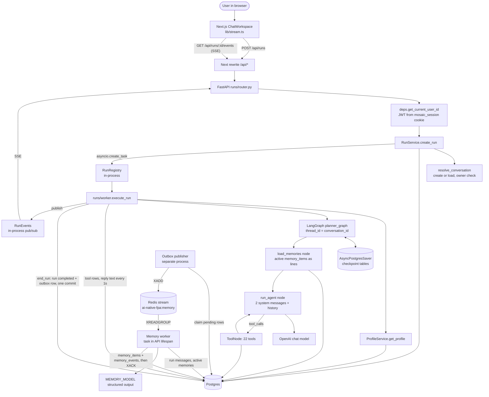
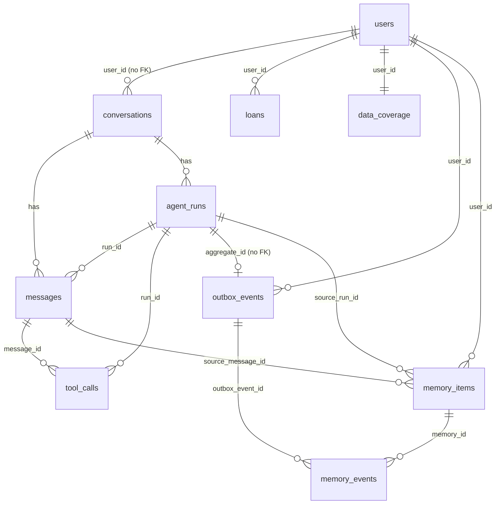

# Project Context — AI Native Financial Planner

Snapshot of the code on `main` at commit `ba3613f` (20 October 2026).
The previous snapshot was `16003e3` (17 October 2026). Since then:
- the checkpointer was made durable;
- memory management was added (outbox, Redis Streams, memory worker, memory tables);
- the agent now loads memories into its prompt.

Everything here was read from the code. Where a doc in the repo disagrees with the code, the code wins.
Those stale docs are listed in section 7. A detailed memory audit is in `docs/MEMORY_IMPLEMENTATION_STATUS.md`.

---

## 1. Project overview

### 1.1 Purpose

A personal financial planner for Indian households, driven by chat.

- The user talks to an agent named **Preeti**.
- Preeti saves the user's financial details into Postgres as structured rows.
- Preeti answers questions from those rows and runs exact calculations through tools.
- The model is told never to do maths itself. Every number must come from a tool.
- After each chat turn, a background worker pulls out lasting preferences and life events.
  These are shown to Preeti in later chats ("avoids sectors: tobacco").

### 1.2 Financial use case

| Area | What is stored | Tables |
|---|---|---|
| Profile | Name, DOB, city, risk appetite, retirement age, life expectancy | `users` |
| Family | Spouse, children, parents, dependants | `family_members` |
| Cash flow | Regular income, regular expenses, one-off transactions | `income_sources`, `expenses`, `transactions` |
| Assets | Bank accounts, FD/RD, EPF/PPF/NPS/VPF, property, gold, vehicles | `bank_accounts`, `fixed_deposits`, `retirement_accounts`, `physical_assets` |
| Liabilities | Loans, credit cards | `loans`, `credit_cards` |
| Protection | Term, health, life, ULIP, vehicle policies | `insurance_policies` |
| Planning | Goals, goal-to-asset allocations, rate assumptions, tax regime | `goals`, `goal_allocations`, `assumptions`, `tax_profile` |
| Onboarding | Per-section status: pending / provided / none / declined | `data_coverage` |
| Preferences and life events | Sectors to avoid or prefer, answer style, past decisions, life events | `memory_items`, `memory_events` |
| Market data (not wired to agent) | Stock and mutual fund master lists | `stocks`, `mutual_funds`, `holdings`, `sip_plans` |
| Tracking (not wired) | Net worth by date | `net_worth_snapshots` |

Currency is INR. Amounts are `Numeric(14, 2)`. Rates are `Numeric(5, 2)` percent values.

The five tables in the last two rows exist in the database but have no SQLAlchemy model. `alembic check` reports them.

### 1.3 User types and roles

- **One role only:** a signed-in individual who owns their own data.
- No admin, advisor, family-sharing or organisation roles exist.
- Authorization is row scoping by `user_id`. There is no RBAC.
- Note: the system prompt says Preeti helps "finance teams and business owners".
  The tools and tables are personal finance. This mismatch is worth fixing.

### 1.4 Technologies

**Backend** — Python 3.13, managed with `uv` (`backend/pyproject.toml`)

| Concern | Choice |
|---|---|
| HTTP | FastAPI + Uvicorn |
| Agent | LangGraph `StateGraph` + `ToolNode`, LangChain tools |
| Model | OpenAI via `langchain-openai`. `CHAT_MODEL` and `MEMORY_MODEL` both default to `gpt-4o-mini` |
| Database | PostgreSQL, SQLAlchemy 2 async, psycopg 3 driver |
| Migrations | Alembic, `0001` to `0014` |
| Conversation state | `AsyncPostgresSaver` (`langgraph-checkpoint-postgres`) on a psycopg pool |
| Event transport | Redis Streams via `redis` 8 (`redis.asyncio`), consumer group `memory-workers` |
| Auth | Argon2 (`pwdlib`) passwords, HS256 JWT (`pyjwt`) in an httpOnly cookie |
| Streaming | Server-sent events from an in-process pub/sub |
| Tests | `pytest` + `pytest-asyncio`, against real Postgres and Redis |
| Installed, not used yet | `langsmith`, `tenacity`, `pycryptodome`, `openpyxl`, `pdfplumber` |

**Frontend** — Next.js 16.3.4, React 19.2.8, TypeScript, Tailwind 4, Recharts, Framer Motion, KaTeX, pnpm.

**Services** — Postgres, Redis and the OpenAI API. No object storage, no vector store.

### 1.5 Repository structure

```
ai-native-fpa/
├── backend/
│   ├── app/
│   │   ├── main.py              FastAPI app; lifespan builds the graph and starts the memory worker
│   │   ├── api/                 router.py (mounts /api), deps.py (current user)
│   │   ├── core/
│   │   │   ├── config.py        Settings from env
│   │   │   └── redis.py         shared Redis client and stream helpers (XADD, XREADGROUP, XACK, …)
│   │   ├── db/                  session.py (engine, Base), enums.py, models/ (incl. memory.py, outbox.py)
│   │   ├── agent/               graph.py, nodes.py, state.py, context.py, prompt.py, checkpointer.py, tools/
│   │   ├── features/            one folder per domain: router / service / repository / schemas
│   │   │   ├── auth/            signup, signin, signout, me
│   │   │   ├── runs/            POST /runs, SSE events, cancel, background run worker
│   │   │   ├── conversations/   list, get, rename, soft delete
│   │   │   ├── records/         generic list / update / delete across all record kinds
│   │   │   ├── coverage/        what data is still missing
│   │   │   ├── analysis/        goal progress report
│   │   │   ├── outbox/          OutboxRepository, outbox publisher process
│   │   │   ├── memory/          extractor, prompt, rules, repository, context (prompt lines), worker
│   │   │   └── profile, cash_flow, assets, liabilities, protection, planning
│   │   ├── calc/                pure maths: money, growth, goals, cash_flow
│   │   └── services/llm.py      the one place a chat model is built
│   ├── alembic/versions/        0001 … 0014
│   ├── tests/                   calc/, core/, runs/, outbox/, memory/, integration/, conftest.py, support.py
│   └── docs/ROADMAP.md          stale, describes the wiped backend
├── frontend/
│   ├── app/                     page.tsx (planner), signin/, signup/
│   ├── components/chat/         ChatWorkspace, MessageTimeline, Composer, HistoryPanel, …
│   ├── components/dashboard/    cards, all fed by mock data today
│   └── lib/                     api.ts, stream.ts, session.ts, useUploads.ts, mock/
├── infra/docker-compose.yml     local Redis (redis:7.4-alpine, AOF on, port 6380)
├── docs/                        PROJECT_CONTEXT.md, MEMORY_IMPLEMENTATION_STATUS.md,
│                                MEMORY_IMPLEMENTATION_HANDOFF.md, design.md, flow/, folder.md
└── sql/                         early hand-written table drafts + NSE/MF CSV seed data
```

### 1.6 Runtime and deployment

- Local development only. No Dockerfile, CI config or cloud deploy files exist.
- **Processes:**

| Process | Command | Holds |
|---|---|---|
| API | `uv run --python 3.13 fastapi dev app/main.py` (or `fastapi run`) | HTTP routes, run worker tasks, **memory worker task** |
| Outbox publisher | `uv run --python 3.13 python -m app.features.outbox.publisher` | moves outbox rows to Redis |
| Postgres | Docker container `ai-native-fpa`, port 5433, database `fpa` | all durable data |
| Redis | Docker container `ai-native-fpa-redis` (`infra/docker-compose.yml`), port 6380 | memory event stream |

- The memory worker can also run on its own with `python -m app.features.memory.worker`. That is not used today.
- The backend must run as **one Uvicorn process**. Several parts depend on that (see 2.3).
- Frontend proxies `/api/*` and `/health` to `BACKEND_ORIGIN` (default `http://127.0.0.1:8000`).
  See `frontend/next.config.ts`. One origin, so no CORS on the backend.
- Settings read by the backend (`backend/app/core/config.py`):

| Setting | Default |
|---|---|
| `OPENAI_API_KEY` | required |
| `CHAT_MODEL` | `gpt-4o-mini` |
| `DATABASE_URL` | none (local: `postgresql://…@localhost:5433/fpa`) |
| `JWT_SECRET` | required |
| `TOKEN_TTL_MINUTES` | 7 days |
| `COOKIE_SECURE` | `false` |
| `REDIS_URL` | required (local: `redis://localhost:6380/0`) |
| `REDIS_MEMORY_STREAM` | `ai-native-fpa:memory` |
| `REDIS_MEMORY_CONSUMER_GROUP` | `memory-workers` |
| `REDIS_MEMORY_CONSUMER_NAME` | `memory-worker-1` |
| `MEMORY_WORKER_BATCH_SIZE` | `10` |
| `MEMORY_WORKER_RETRY_LIMIT` | `5` |
| `MEMORY_WORKER_CLAIM_AFTER_SECONDS` | `300` |
| `MEMORY_MODEL` | `gpt-4o-mini` |

- `backend/.env.example` lists more keys (`ROUTER_MODEL`, `CHECKPOINT_ENCRYPTION_KEY`, …).
  These are leftovers. `Settings` ignores them.

---

## 2. Architecture

### 2.1 Diagram



### 2.2 Request lifecycle

The frontend turns one user message into two HTTP calls.
Source: `frontend/lib/stream.ts`, `docs/flow/tool-events.md`.

**Step 1 — User sends a message**

- `createRun` posts `{conversation_id, client_request_id, message}` to `POST /api/runs`.
- `client_request_id` is a fresh UUID per message. The POST is retried on network error.
- `conversation_id` is `null` for a new chat.

**Step 2 — Authentication and authorization**

- `get_current_user_id` reads the `mosaic_session` cookie and decodes the JWT (`backend/app/api/deps.py`).
- Missing or invalid token → `401`. Token TTL is 7 days by default.
- There is no per-route permission check. Every query filters by `user_id` instead.
- Example: `RunRepository.get_conversation` requires `user_id` match and `status != deleted`.

**Step 3 — Conversation is identified**

- `RunService.resolve_conversation` in `backend/app/features/runs/service.py`.
- No id → create a `conversations` row, title from the first message (`titles.title_from`).
- Id given → load it for this user, else `404`.
- Idempotency: same `(conversation_id, client_request_id)` returns the existing run.
- One active run per conversation, enforced by partial unique index `uq_agent_runs_one_active`.
  A second message during a reply gets `409`.

**Step 4 — Persist the turn before running**

- `create_run_with_messages` inserts, in one transaction:
  - `agent_runs` row, status `queued`.
  - User `messages` row, `completed`, `content = {"text": ...}`.
  - Empty assistant `messages` row, status `streaming`.
- Sequence numbers come from `conversations.current_sequence`, bumped with one `UPDATE … RETURNING`.
- Commit, then `run_registry.start(...)` launches `execute_run` as an asyncio task.
- API answers `202 {run_id, conversation_id, status}`.

**Step 5 — Context is loaded and assembled**

- `worker.stream_events` loads the profile with `ProfileService.get_profile`.
  Only `BASIC_FIELDS`: name, email, DOB, city, risk appetite, retirement age, life expectancy.
- It builds `PlannerContext(user_id, profile)` — frozen, read-only, per run.
- Graph config: `{"configurable": {"thread_id": str(conversation_id)}}`.
- Graph input is only the new `HumanMessage`. Earlier turns come from the **Postgres checkpointer**, not from `messages`.
- The first graph node, `load_memories` (`backend/app/agent/nodes.py`):
  - reads up to 50 `active` `memory_items` for `user_id`, newest first;
  - turns each into a line with `describe_memory` (`features/memory/context.py`), such as `Investment: avoids sectors: tobacco`;
  - writes them to `state["memories"]`. It replaces the old list on every run, so no stale memories carry over.
- `run_agent` builds the model input each step:
  - `SystemMessage` 1 = `SYSTEM_BASE_INSTRUCTIONS` + `TOOL_USAGE_INSTRUCTIONS` + profile block + today's date.
  - `SystemMessage` 2 = `## What you remember about the user` + the memory lines, or "Nothing yet."
  - Then every message in `state["messages"]`, with no trimming.
- All other financial data is not in the prompt. The model must call `list_records`.

**Step 6 — Model is called**

- `llm_service.with_tools(ALL_TOOLS).astream(messages)` — OpenAI, streaming.
- All 22 tools are bound on every call.
- Chunks are added together into one `AIMessage` and returned to state.

**Step 7 — Tools are selected and executed**

- Graph: `START → load_memories → agent → (tools_condition) → tools → agent → … → END`.
- Loop limit is LangGraph's default recursion limit. No custom cap.
- Tools read `runtime.context.user_id`, so a tool can only touch the caller's rows.
- Each tool opens its own short DB session via `SessionLocal()`.
- Tools return plain strings, for example `"Saved loan with id 7: …"` or `"Not saved. Required details missing …"`.
- Tool groups:

| Group | Tools |
|---|---|
| Read / onboarding | `get_missing_data`, `update_data_coverage`, `list_records` |
| Change | `update_record`, `delete_record` (prompt asks user to confirm first) |
| Save | `update_profile`, `add_family_member`, `add_income_source`, `add_expense`, `add_transaction`, `add_bank_account`, `add_fixed_deposit`, `add_retirement_account`, `add_physical_asset`, `add_loan`, `add_credit_card`, `add_insurance_policy`, `add_goal`, `allocate_goal`, `set_assumption`, `set_tax_profile` |
| Calculate | `check_goal_progress` |

- Delete confirmation is a prompt rule only. Nothing in code blocks an unconfirmed delete.
- `list_records` has a 5 second `asyncio.sleep` marked `TODO(orb-demo)`. It must go before production.
- Preferences and life events have **no tool**. The prompt tells the model to say it will remember them.
  The memory worker saves them after the turn.

**Step 8 — Response is streamed**

- Graph runs with `stream_mode=["messages", "updates"]`.
- `updates` with `AIMessage.tool_calls` → `tool.started` event.
- `updates` with `ToolMessage` → `tool.finished` event, status `ok` or `error`.
- `messages` chunks with text → `assistant.delta` event.
- Events go to `RunEvents.publish`, which copies them into every listener queue.
- `GET /api/runs/{id}/events` streams them as SSE until `run.completed`, `run.failed` or `run.cancelled`.
- A late listener gets the tool steps so far plus an `assistant.snapshot` of text so far.
- If the run already ended, the route returns one final event built from the DB.

**Step 9 — Messages, events and state are persisted**

| What | Where | When |
|---|---|---|
| User message | `messages` | Before the run starts |
| Assistant text | `messages.content.text` | Every 1 second during streaming, and at the end |
| Run status | `agent_runs` | queued → running → completed / failed / cancelled |
| Tool call | `tool_calls` (args JSONB) | When the model asks for it, status `running` |
| Tool result | `tool_calls.output = {"text": …}` or `error_text` | When the tool returns |
| Financial data | domain tables | Inside the tool, own transaction |
| Full LangGraph state | checkpoint tables (`AsyncPostgresSaver`) | After every node, durable |
| Memory extract event | `outbox_events` | In the same commit that marks the run `completed` |
| Live text and tool steps | `RunEvents.texts` / `.tools` | Process memory, cleared on final event |

- On cancel: run → `cancel_requested`, task cancelled, run and message end as `cancelled`, open tool rows closed. No outbox row.
- On error: run `failed` with `failure_code="agent_error"`, user sees a generic message. No outbox row.

**Step 10 — Background jobs**

- **Run worker:** a per-run asyncio task in the API process (unchanged).
- **On startup:** `fail_orphaned_runs` marks every active run as `failed` (`worker_restart`).
- **Outbox publisher** (`features/outbox/publisher.py`, separate process):
  - every second, it locks up to 10 due `pending` rows (`FOR UPDATE SKIP LOCKED`);
  - it runs `XADD` to `ai-native-fpa:memory` and marks them `published`;
  - on a Redis error it backs off `2^attempts` seconds, and sets `dead_letter` after 5 tries.
- **Memory worker** (`features/memory/worker.py`, a task started in the API `lifespan`):
  - At startup, it creates the group and replays its own unacknowledged entries.
  - Each loop: `XAUTOCLAIM` entries idle for 300 s, then `XREADGROUP` blocking 5 s.
  - Per event, it skips if `memory_events` already has this `outbox_event_id`.
  - Otherwise it loads the run's messages (owner checked) and the user's active memories.
  - It calls `MEMORY_MODEL`, applies the rules (section 3.4), saves, commits, then `XACK`s.
  - On failure there is no ack. After more than 5 deliveries the entry is copied to `ai-native-fpa:memory:dead`.
- No summarisation, embedding or cleanup job exists. Their event types are defined, but nothing sends them.

### 2.3 Single-process assumptions

These break as soon as there are two Uvicorn workers or two hosts:

- `RunRegistry` — cancel only works in the process that runs the task.
- `RunEvents` — the SSE listener must hit the same process as the worker.
- `fail_orphaned_runs` — fails runs that other live workers own (a TODO in the code says so).
- `agent_runs.worker_id` and `heartbeat_at` exist but are never written.
- Memory worker — the consumer name is fixed at `memory-worker-1`. Two API processes would share it.

No longer a limit: conversation state is now in Postgres, so any process can continue a thread.

---

## 3. Current memory model

The project has five kinds of "memory".

### 3.1 Long-term structured memory (Postgres, durable)

- This is what the prompt calls "your memory".
- Domain tables in section 1.2, written only through tools, synchronously during the run.
- Every row has `user_id`, so it is per user and shared across all conversations.
- Read path 1: the basic profile is pushed into system message 1 on every model call.
- Read path 2: everything else is pulled by `list_records(kind)`.
- `data_coverage` remembers which sections were asked, answered, declined or empty.

Example flow — user says "I have an HDFC home loan":

- Model calls `add_loan` with what the user gave.
- `save_record` in `agent/tools/common.py` finds missing required fields.
- Tool returns `"Not saved. Required details missing for this loan: …"`.
- Model asks the user. Next turn it calls `add_loan` again with everything.
- Row lands in `loans`. Coverage section `loans` becomes provided.

### 3.2 Short-term conversation memory (LangGraph checkpointer, durable)

- `backend/app/agent/checkpointer.py`: `open_checkpointer()` opens a psycopg pool.
  - The pool uses `autocommit=True`, `prepare_threshold=None`, `dict_row`.
  - It runs `setup()`, then the lifespan builds `build_planner_graph(checkpointer)`.
- Tables: `checkpoints`, `checkpoint_blobs`, `checkpoint_writes`, `checkpoint_migrations`.
  They are owned by LangGraph and left out of Alembic through `include_name` in `alembic/env.py`.
- Keyed by `thread_id = conversation_id`.
- Holds every `HumanMessage`, `AIMessage` (with tool calls), `ToolMessage`, and the `memories` list of the thread.
- This is the **only** chat history the model sees. The `messages` table is never read back into the graph.

### 3.3 Display history (Postgres, durable)

- `messages` and `tool_calls`, read by `GET /api/conversations/{id}` for the UI.
- Only user and assistant text is returned. Tool rows become `tools[]` on the assistant message.

### 3.4 Long-term preference and episodic memory (Postgres, durable, async)

- Tables: `memory_items` (current and old memories) and `memory_events` (history).
- Written only by the memory worker, after a run completes, never during the run.
- Types: `preference` (from the user's words only) and `episodic` (life events, past decisions).
- Namespaces: `investment_preferences`, `communication_preferences`, `financial_attitudes`, `life_events`, `past_decisions`.
- Rules (`features/memory/rules.py`):
  - Drop a memory with a wrong type or namespace, or with empty content.
  - Drop a memory whose source is not a user message of this run.
  - Drop a memory whose confidence is below 0.5.
  - Drop a memory whose key names data the financial tables own: income, salary, expense, balance, net worth, asset, loan, insurance, tax, currency, holding, price, risk appetite, retirement age.
  - An `investment_preferences` memory must have `stance: avoid | prefer` in its content, or it is dropped.
  - Explicit and confidence ≥ 0.8 → `active`. Otherwise → `candidate`.
  - Preferred keys: `excluded_sectors`, `preferred_sectors`, `excluded_companies`, `preferred_fund_types`, …
- Updates: the extractor is shown current memories and reuses their key.
  `save_candidate` marks the old row `superseded` and inserts a new `active` row, with 2 history rows.
- Read path: `load_memories` graph node → system message 2 (step 5). Only `active`, at most 50.

Example flow — user says "I avoid tobacco stocks":

- The run completes, and `end_run` commits the run plus an outbox row.
- The publisher sends it to Redis, and the memory worker reads it.
- The LLM proposes `excluded_sectors = {"sectors": ["tobacco"], "stance": "avoid"}`, explicit, 1.0.
- The rules pass it as `active`. It is saved with a `created` history row, then `XACK`.
- In the next chat, system message 2 has `- Investment: avoids sectors: tobacco`.

### 3.5 Delivery log (Postgres + Redis)

- `outbox_events` keeps every event with its status, attempts and last error.
- The Redis stream `ai-native-fpa:memory` keeps entries. There is no trimming yet.

---

## 4. Gaps relevant to memory management

Ordered by impact. Items marked **Resolved** are kept for history.

**4.1 Conversation memory is lost on every restart — Resolved**

- Fixed by `AsyncPostgresSaver` (section 3.2). Threads survive restarts.

**4.2 History grows without limit**

- `run_agent` sends `[system, memory, *state["messages"]]` every step.
- Tool outputs (full `list_records` dumps) stay in state forever.
- Long chats will hit the context window and cost more on every turn.

**4.3 Summary columns exist but are unused**

- `conversations.summary` and `conversations.summarized_through_sequence` — never written or read.
- `PlannerState.turn_count` — declared, never set.
- `memory.summary.requested` exists as an event type. Nothing sends it, and the worker acks it as unknown.

**4.4 Cancelled or failed runs can leave a broken thread**

- Cancel during a tool step can leave an `AIMessage` with `tool_calls` and no matching `ToolMessage`.
- OpenAI rejects that history on the next call.
- This is **worse now**: checkpoints are durable, so a broken thread stays broken after a restart.
- Not confirmed by a test. Worth checking first.

**4.5 Two histories can disagree**

- `messages` has the partial text of a cancelled reply. The checkpoint may not.
- Tool output in `tool_calls.output` is a string copy, not linked to the checkpoint.
- There is no single source of truth to rebuild context from.

**4.6 Structured memory has no history or provenance**

- `update_record` and `delete_record` overwrite or remove rows. No audit log, no versions.
- No record of which conversation, run or tool call created a row.
- `conversations.user_id` has no foreign key to `users`.
- Preference memory does have this (`memory_events`, `source_*` columns). Financial tables do not.

**4.7 Preference memory is write-and-read only**

- `candidate` memories are never shown to the user and cannot be confirmed or rejected.
- `confirmed_by_user` is never set to `true`.
- No API, tool or UI lets the user list, correct or delete a memory.
- `valid_from`, `valid_until` and `expires_at` exist but are unused. Nothing expires.
- A preference said in this chat is saved only after the turn. Until then, the prompt rule "newer statement wins" covers it.

**4.8 Prompt context is fixed**

- Profile and up to 50 memories are injected every time. Other data needs a tool call every time.
- No selection of relevant memories per question. No token budgeting.
- All 22 tool schemas are sent on every call.
- No embeddings or vector store. This is a stated non-goal for v1.

**4.9 Privacy and retention**

- Conversation delete is soft: `status = deleted`, `deleted_at` set. Messages, tool rows, checkpoints and memories stay.
- No account delete, export or retention rule.
- Tool arguments and outputs with financial data are stored as plain JSONB.
- `outbox_events` rows and Redis stream entries are never cleaned up.
- `CHECKPOINT_ENCRYPTION_KEY` in `.env.example` hints at a plan. Nothing reads it.

**4.10 Scaling and deployment**

- See 2.3. The memory worker needs a unique consumer name per process before scaling out.
- No deploy config for the outbox publisher. Production needs it as a second, always-on process.

---

## 5. Data model for conversations, runs and memory

All ids are `BIGINT` identity columns. All timestamps are `TIMESTAMPTZ`.



| Table | Key columns | Notes |
|---|---|---|
| `conversations` | `id`, `user_id`, `title`, `status`, `current_sequence`, `summary`, `summarized_through_sequence`, `deleted_at` | Summary columns unused |
| `messages` | `conversation_id`, `run_id`, `sequence_number`, `role`, `status`, `content` JSONB | Unique on `(conversation_id, sequence_number)`. Only `{"text"}` used |
| `agent_runs` | `conversation_id`, `client_request_id`, `status`, `failure_code`, timestamps, `worker_id`, `heartbeat_at`, `version` | One active run per conversation |
| `tool_calls` | `conversation_id`, `message_id`, `run_id`, `tool_call_id`, `tool_name`, `arguments`, `status`, `output`, `error_text` | Unique on `(conversation_id, tool_call_id)` |
| `outbox_events` | `event_type`, `aggregate_type`, `aggregate_id`, `user_id`, `payload` JSONB, `status`, `attempts`, `available_at`, `last_error`, `processed_at` | Unique on `(event_type, aggregate_type, aggregate_id)`. Index on `(status, available_at)`. Migration `0014` |
| `memory_items` | `user_id`, `memory_type`, `namespace`, `memory_key`, `content` JSONB, `confidence`, `confirmed_by_user`, `status`, `source_message_id`, `source_conversation_id`, `source_run_id`, `valid_from`, `valid_until`, `expires_at` | Partial unique on `(user_id, namespace, memory_key) WHERE status = 'active'`. Migration `0014` |
| `memory_events` | `memory_id`, `user_id`, `event_type`, `old_content`, `new_content`, `source_*`, `outbox_event_id`, `actor_type`, `reason` | Append-only history. Migration `0014` |
| `checkpoint*` (4 tables) | `thread_id`, checkpoint ids, blobs | Owned by LangGraph `setup()`, not Alembic |

New Postgres enum types in `0014`: `outbox_status`, `outbox_event_type`, `memory_status`, `memory_event_type`, `memory_actor_type`.

---

## 6. Frontend notes that touch memory

- `lib/session.ts` keeps the signed-in user in browser memory, from `GET /api/auth/me`.
- `lib/stream.ts` follows a live run again after reload, using `active_run` from the conversation detail.
- The dashboard reads `lib/mock/data.ts`. It is not connected to the user's saved data.
- `lib/api.ts` and `lib/useUploads.ts` call `/api/v1/documents/*` for file import.
  Those routes do not exist in the current backend. Upload is not working end to end.
- There is no UI for saved preference memories yet.

---

## 7. Stale or misleading files

| File | Why it misleads |
|---|---|
| `backend/docs/ROADMAP.md` | Describes the old, wiped backend (`/api/v1/planner/messages`, 24 tables, 132 tests) |
| `docs/folder.md` | A planned layout (`modules/`, `workers/`, `redis_client.py`) that was never built |
| `docs/MEMORY_IMPLEMENTATION_HANDOFF.md` | The original plan. It uses UUID ids, Upstash and `app/workers/` / `app/events/` folders. The code uses BIGINT, local Redis and `features/outbox`, `features/memory` |
| `docs/MEMORY_IMPLEMENTATION_STATUS.md` | Audit from before `ba3613f`. It still says memories are never read back. That is now done by `load_memories` |
| `backend/.env.example` | Keys `Settings` does not read; `REDIS_URL` and the memory settings are missing |
| `sql/*.sql` | Early drafts with UUID keys. Alembic is the real schema |

---

## 8. Facts to keep when changing memory

- The model must never do maths. Numbers come from tools. Keep this in any summary design.
- The model must call saved data "memory", never "database" or "record", in replies.
- Tools must keep scoping by `runtime.context.user_id`.
- `client_request_id` idempotency and one-active-run-per-conversation must keep working.
- The SSE event names in `features/runs/events.py` are a contract with the frontend.
- Exact financial facts live in the structured tables. `memory_items` must never hold balances, income, prices or other data a table owns.
- Never publish to Redis directly after a DB write. Write an `outbox_events` row in the same commit instead.
- `XACK` only after the Postgres commit. Every handler must be safe to run twice (`outbox_event_id` check).
- Investment preferences must always carry `stance`. A dislike must never read as a liking.
- The memory system message heading `## What you remember about the user` is referenced by a prompt rule. Change both together.
- The Redis client's `socket_timeout` (30 s) must stay longer than the worker's `XREADGROUP` block (5 s).
