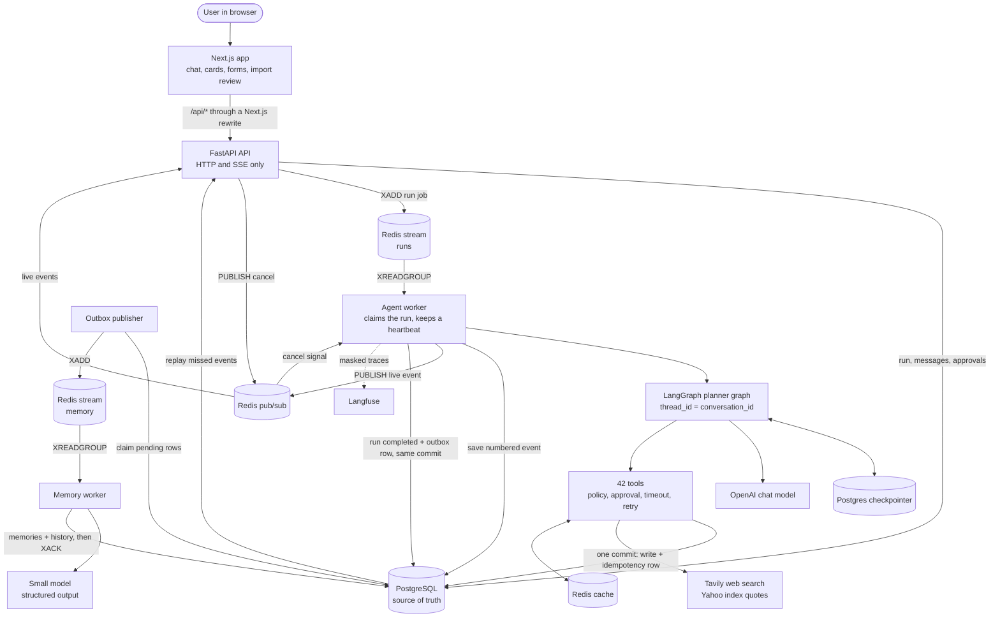
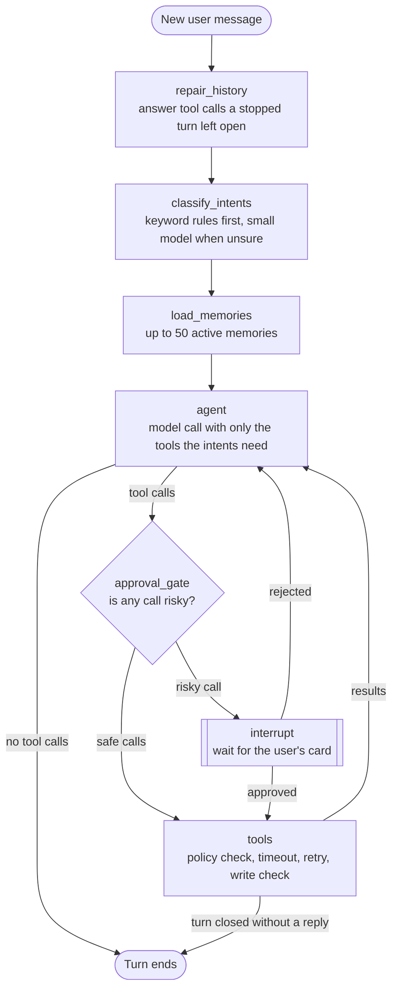
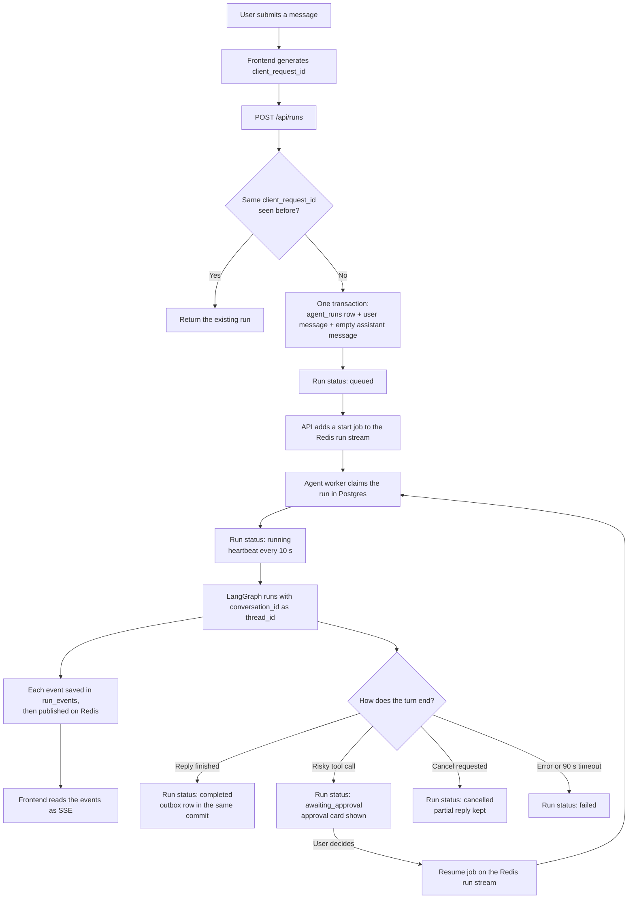
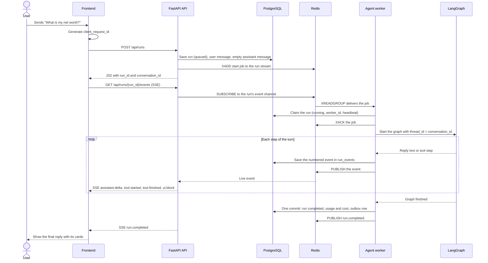
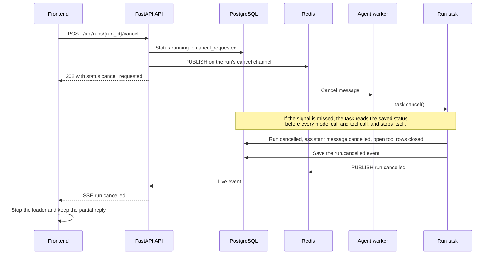
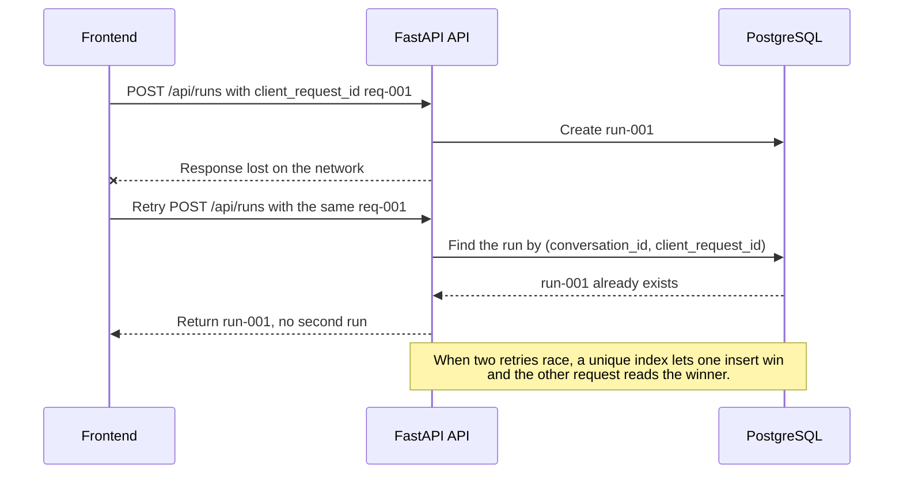
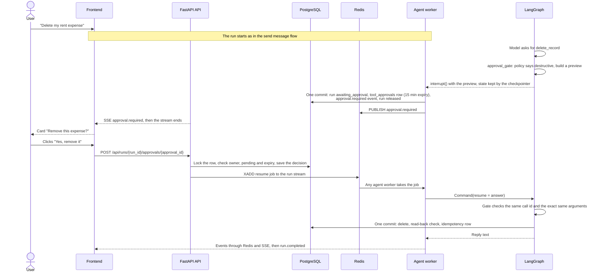
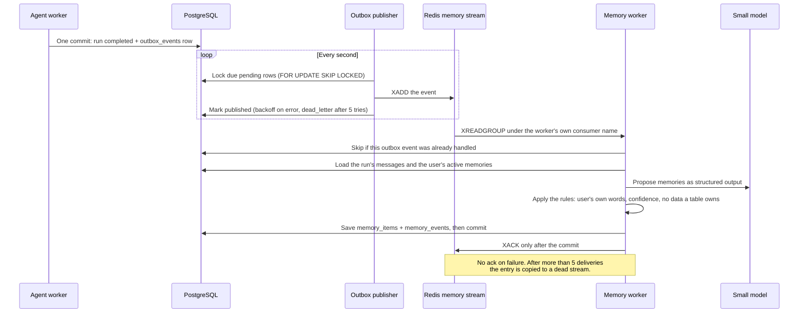
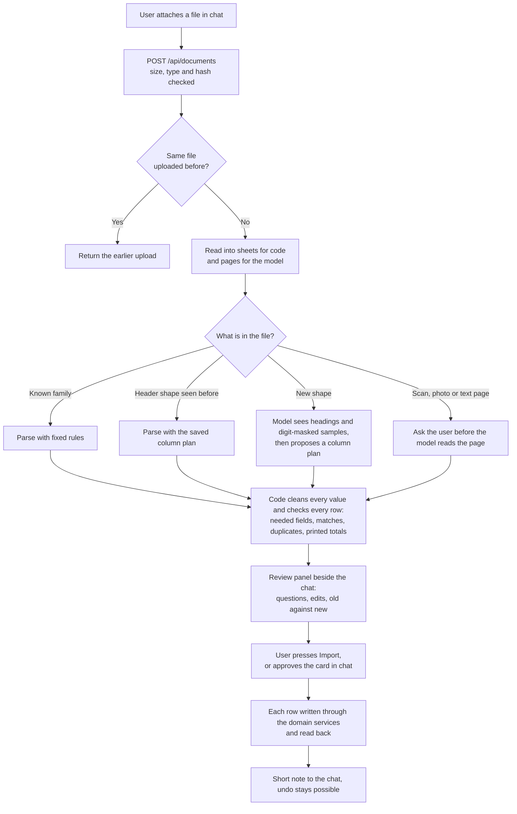

# Flow diagrams

Each diagram below is drawn by GitHub from its `.mmd` source file in this folder.
The source is the truth: change the `.mmd` file, then copy it here.

| # | Diagram | Shows | Source |
|---|---|---|---|
| 1 | [System architecture](#1-system-architecture) | Every process, store and outside service, and what moves between them. | [system-architecture.mmd](system-architecture.mmd) |
| 2 | [Agent graph](#2-agent-graph) | The LangGraph nodes one chat turn passes through. | [agent-graph.mmd](agent-graph.mmd) |
| 3 | [Run lifecycle](#3-run-lifecycle) | The states of one run, from the user's message to its end. | [run-lifecycle.mmd](run-lifecycle.mmd) |
| 4 | [Send a message](#4-send-a-message) | One chat turn across the API, Redis, the agent worker and Postgres. | [send-message-sequence.mmd](send-message-sequence.mmd) |
| 5 | [Cancel a run](#5-cancel-a-run) | How Stop reaches a run that lives in another process. | [cancel-run-sequence.mmd](cancel-run-sequence.mmd) |
| 6 | [Idempotent retry](#6-idempotent-retry) | Why a retried request never creates a second run. | [idempotent-retry-sequence.mmd](idempotent-retry-sequence.mmd) |
| 7 | [Approval before a risky tool call](#7-approval-before-a-risky-tool-call) | Pause, show a card, and resume on any worker. | [approval-sequence.mmd](approval-sequence.mmd) |
| 8 | [Memory pipeline](#8-memory-pipeline) | Outbox, Redis stream and the memory worker after a run completes. | [memory-pipeline.mmd](memory-pipeline.mmd) |
| 9 | [Document import](#9-document-import) | From an uploaded file to checked rows the user approves. | [document-import-flow.mmd](document-import-flow.mmd) |

To export every diagram as a PNG with the same name:

```bash
for f in docs/flow/*.mmd; do
  npx -y @mermaid-js/mermaid-cli -i "$f" -o "${f%.mmd}.png" -t dark -b "#1a1a1a" -s 2
done
```

## 1. System architecture

Every process, store and outside service, and what moves between them.



## 2. Agent graph

The LangGraph nodes one chat turn passes through.



## 3. Run lifecycle

The states of one run, from the user's message to its end.



## 4. Send a message

One chat turn across the API, Redis, the agent worker and Postgres.



## 5. Cancel a run

How Stop reaches a run that lives in another process.



## 6. Idempotent retry

Why a retried request never creates a second run.

Image: [idempotent-retry-sequence.png](idempotent-retry-sequence.png)



## 7. Approval before a risky tool call

Pause, show a card, and resume on any worker.



## 8. Memory pipeline

Outbox, Redis stream and the memory worker after a run completes.



## 9. Document import

From an uploaded file to checked rows the user approves.


